# Next Day

Next Day is a pixel art day planner for Windows. Every evening you plan only the next day: give it a name, write what you will do and make a checklist. During the day you tick what is done, and in the evening you collect the results on a board and seal the day. Big goals become maps of topics, and the app puts their tasks into your plan by itself. A drill trainer works for any subject that fits into questions and answers, from foreign words to driving test questions. A built-in MCP server lets AI assistants such as Claude read your history and build goals with you. The interface is in English and Russian.

Download the installer from [Releases](https://github.com/IgorBerezkin/NextDay/releases/latest).

<details>
<summary><b>Русский</b></summary>

## Next Day

Планировщик на один день вперёд для Windows. Вечером вы называете завтрашний день и решаете, чем будете заниматься. Днём отмечаете сделанное, вечером собираете итоги и запечатываете день. Большие цели раскладываются на темы, и программа сама ставит их задачи в план. В зубрилке можно учить любую тему, которая раскладывается на вопросы и ответы, от иностранных слов до билетов ПДД. Программа запускается вместе с Windows, живёт в трее и напоминает о себе утром и вечером.

Планировать можно только завтрашний день, один план на день. Интерфейс на русском и английском, язык переключается в настройках.

### План на завтра

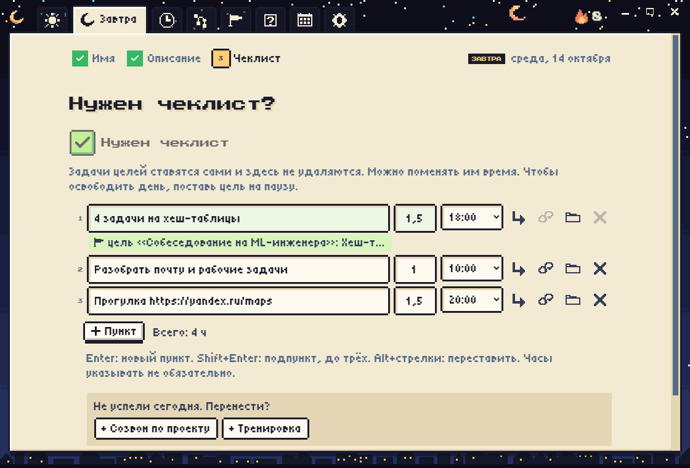

Вечером мастер в три шага спрашивает имя завтрашнего дня, описание и чеклист. У пункта можно указать часы и время начала, добавить до трёх подпунктов, прикрепить файл или связать его с задачей из прошлого дня. То, что не успели сегодня, переносится одной кнопкой. Задачи целей уже стоят в плане и подсвечены зелёным: им можно поменять время, но удалить нельзя.

### Сегодня

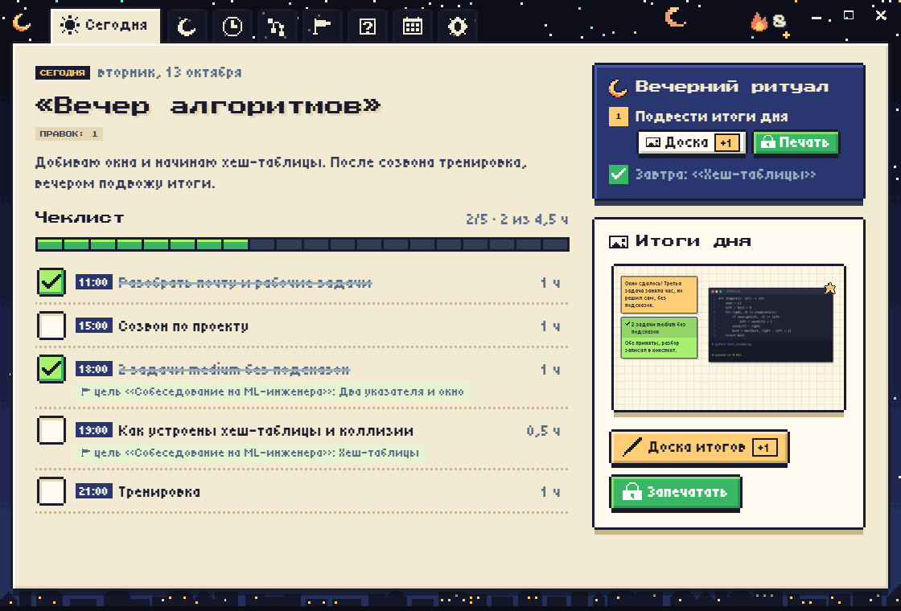

Утром вчерашний план становится сегодняшним. Менять его уже нельзя, можно только отмечать пункты. У пунктов целей есть флажок, клик по нему открывает тему на карте. Вечером справа появляется ритуал: подвести итоги и проверить план на завтра.

### Доска итогов

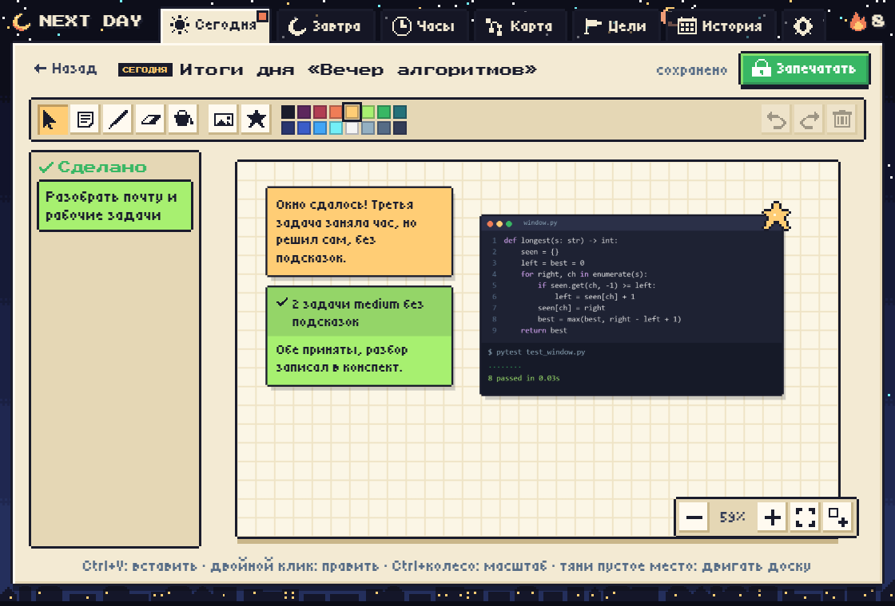

На доску складываются итоги дня. Сделанные пункты ждут слева и становятся карточками, сюда же вставляются скриншоты из буфера, заметки, рисунки и наклейки. Когда итоги собраны, день запечатывается с оценкой от 1 до 5 и остаётся в истории, менять его уже нельзя.

### Часы

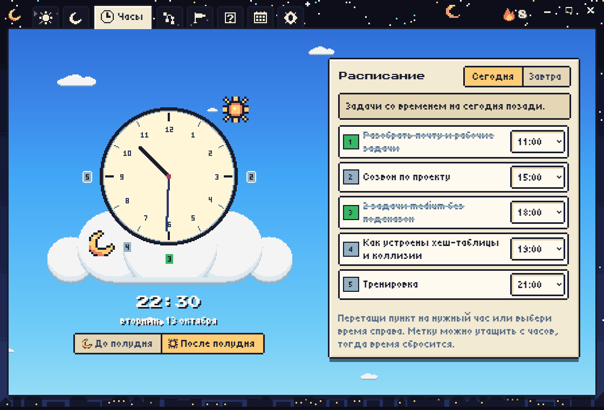

Вкладка «Часы» показывает задачи с временем начала прямо на циферблате. Пункт можно перетащить на нужный час или выбрать время в списке справа. Когда час наступает, приходит напоминание. Переключатель внизу показывает часы до полудня или после.

### История

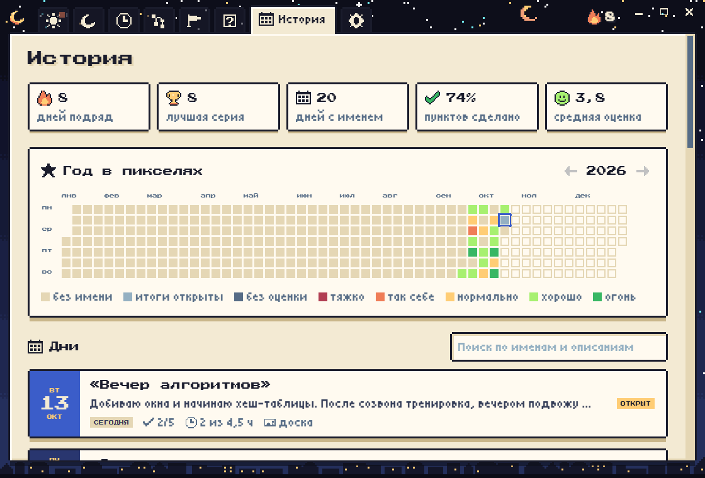

Вверху серия дней подряд, процент сделанных пунктов и средняя оценка. «Год в пикселях» раскрашивает каждый день по оценке. Ниже список всех дней с поиском по именам и описаниям, любой день можно открыть и посмотреть его план и доску.

### Цели

Большую цель можно разложить на темы: что нужно уметь и в каком порядке. У каждой темы свои задачи, от простых к сложным, и у каждой задачи примерное время. Пока цель идёт, Next Day сам ставит её задачи в план на завтра, столько, сколько помещается во время, которое вы отвели цели на день. Если завтрашний день ещё не назван, план появится сам: его можно переименовать и дополнить своими пунктами. Отметки в чеклисте двигают цель вперёд, а недоделанные задачи возвращаются в план. Чтобы пропустить несколько дней, цель ставится на паузу.

#### Карта цели

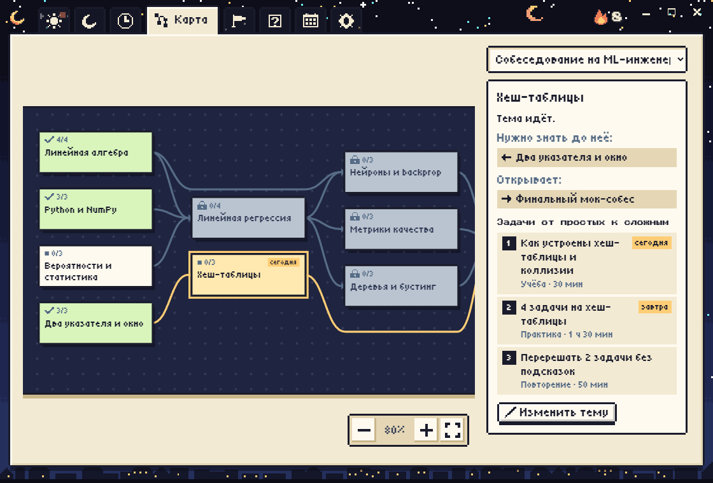

Вкладка «Карта» показывает цель как граф. Стрелка ведёт от темы, которую нужно знать, к теме, для которой она нужна, а справа стоит сама цель. Зелёные темы пройдены, жёлтые идут, светлые открыты, серые закрыты до тех пор, пока не пройдены темы до них. Клик по теме открывает справа её задачи от простых к сложным с пометками «сегодня» и «завтра». Там же задачу можно отметить, записать результат или пропустить. Темы, стрелки и задачи можно добавлять и править прямо на карте.

#### Цель

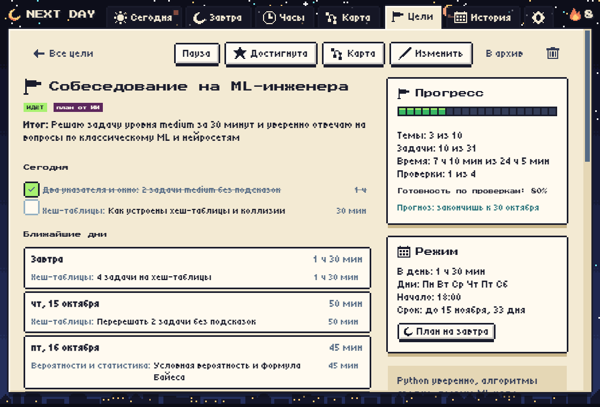

На вкладке «Цели» видно, что стоит на сегодня и что программа поставит в ближайшие дни. Справа прогресс по темам и задачам, готовность по проверкам и прогноз: успеваете ли вы к сроку. В режиме задаются время на день, дни недели, час начала и срок. Кнопки сверху ставят цель на паузу, завершают её или открывают карту.

### Зубрилка

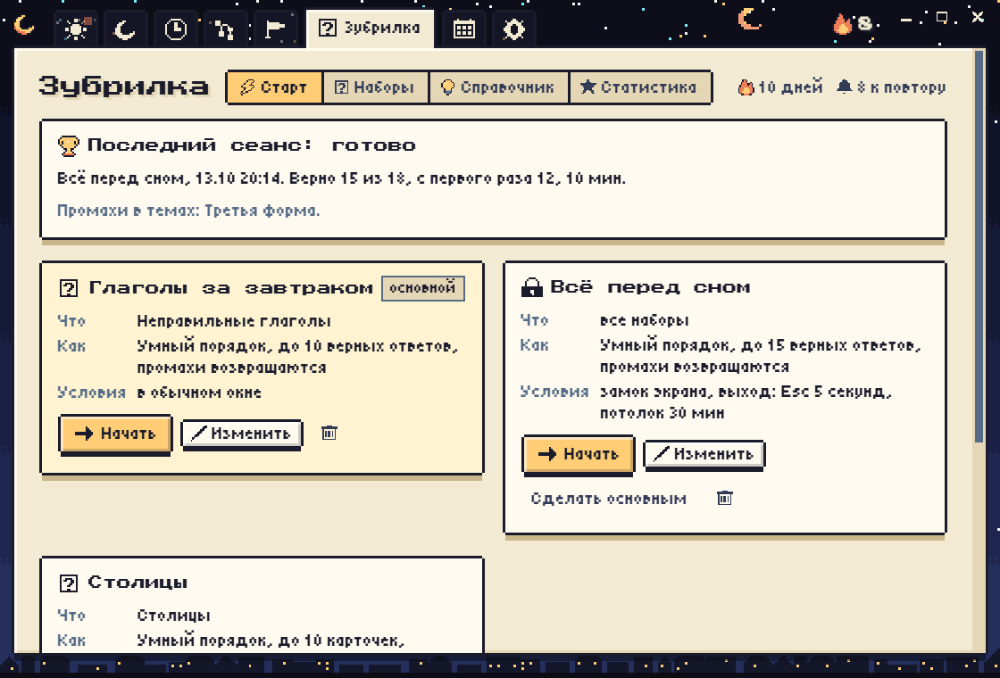

Зубрилка подходит для любой темы, которую можно разложить на вопросы и ответы: иностранные слова, химия, билеты ПДД, даты по истории, термины к экзамену. Наборы вы собираете сами, загружаете готовые из файла или просите собрать ИИ. Карточки идут подряд, пока не наберётся цель сеанса: нужное число верных ответов, карточек или минут. Что повторять и как, задаёт режим. Сеанс идёт в обычном окне или под замком на весь экран: из замка можно выйти, только если держать Esc пять секунд, или когда выйдет время. Серия считает дни подряд, в которые сеанс пройден до конца.

#### Карточки

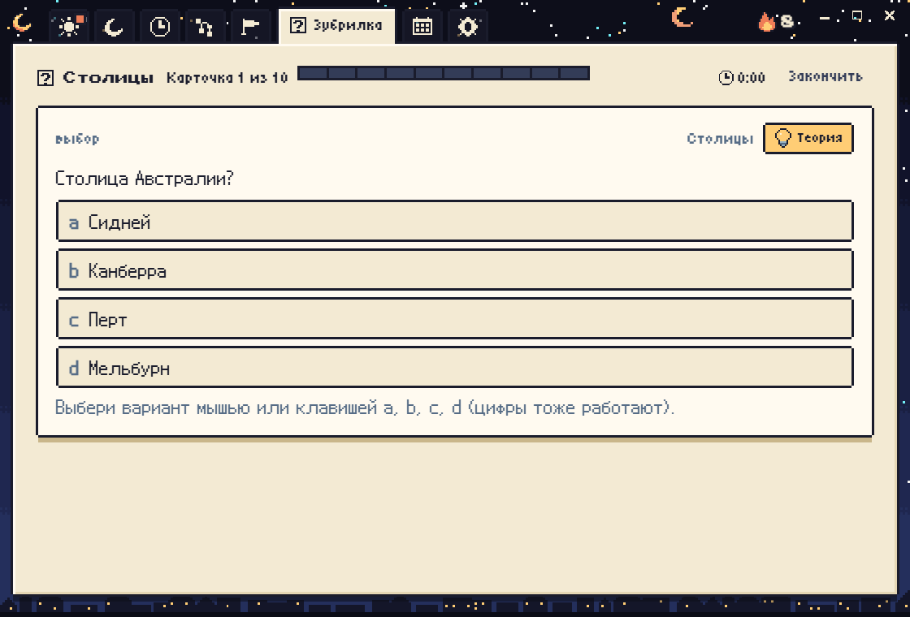

Ответ пишут текстом или числом, выбирают из вариантов мышью или клавишами, а можно вспомнить про себя, открыть ответ и честно отметить, знали ли его. После промаха видно правильный ответ и пояснение, а карточка вернётся позже в том же сеансе. Верный ответ отодвигает карточку: она придёт снова через день, потом через два, четыре и восемь дней. Темы набора можно открывать по очереди: следующая откроется, когда в открытых наберётся нужная доля верных ответов.

#### Наборы

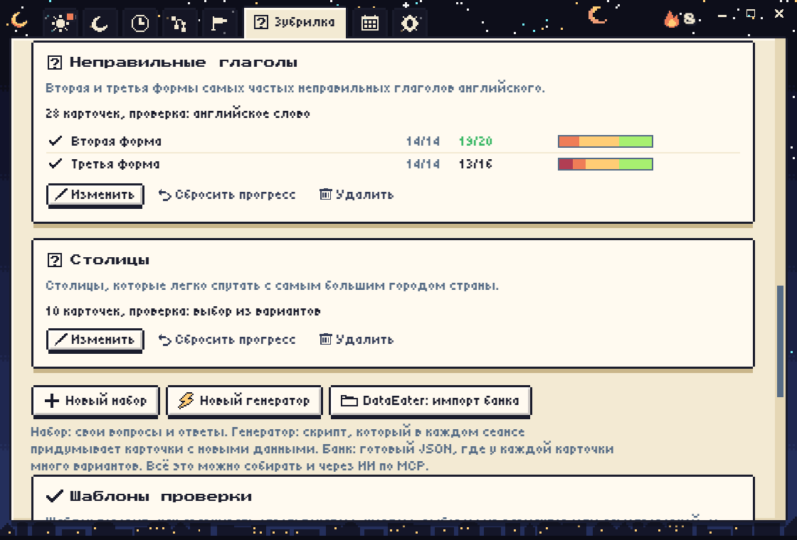

Свои наборы собираются прямо в программе: вопрос, ответ, другие верные ответы, варианты для выбора и пояснение после промаха. Много карточек можно вставить сразу, по одной в строке. Как сравнивать ответ, говорит шаблон проверки: текстом, числом, выбором из вариантов или самопроверкой. Шаблон может подсказывать под полем ответа, в каком виде нужен ответ. Шаблоны лежат в группах, свои шаблоны и группы можно создавать под любую тему.

Если задачу нужно решать снова и снова с новыми данными, вместо набора подойдёт генератор: скрипт на JavaScript, который в каждом сеансе придумывает новые карточки. Генератор работает в песочнице без доступа к сети и к вашим данным и включается только после того, как вы посмотрите примеры его карточек. Готовые банки карточек в JSON загружаются кнопкой «DataEater».

#### Справочник

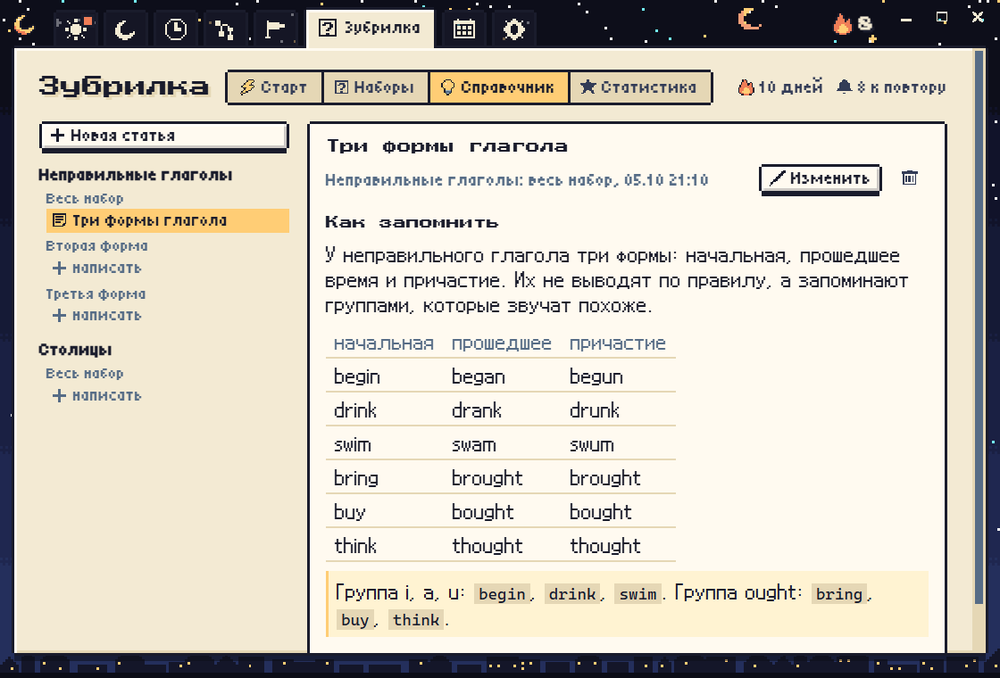

В справочнике лежат статьи к наборам и их темам: правила, таблицы, схемы и графики. Статью можно написать самому или попросить ИИ. Во время сеанса справочник открывается кнопкой с лампочкой.

### ИИ через MCP

Карту цели можно собрать самому или поручить ИИ. В программу встроен MCP-сервер. Через него Claude Code, Claude Desktop или другой клиент MCP видит историю дней, составляет черновик цели, правит карту и записывает результаты. Ещё ИИ может собрать набор для зубрилки, написать статью в справочник, сделать генератор или шаблон проверки и разобрать ваши промахи. Сервер доступен только с этого компьютера и пускает только с ключом.

#### Черновик от ИИ

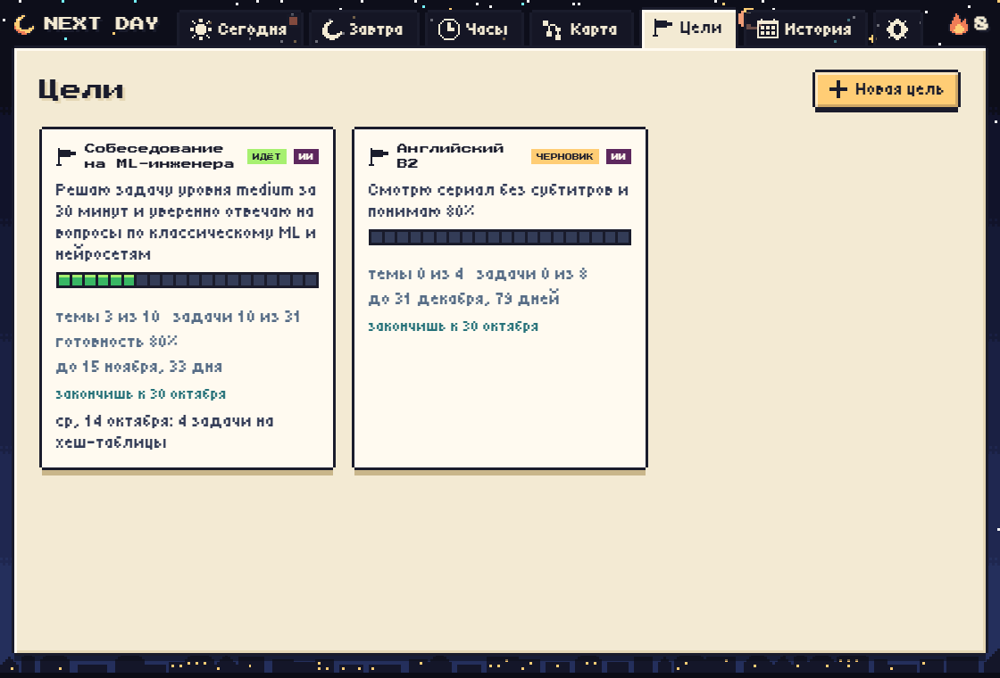

Цель, которую составил ИИ, помечена «ИИ» и сначала лежит черновиком. Она начинает работать, только когда вы откроете её, посмотрите карту и нажмёте «Принять и начать».

#### Настройки

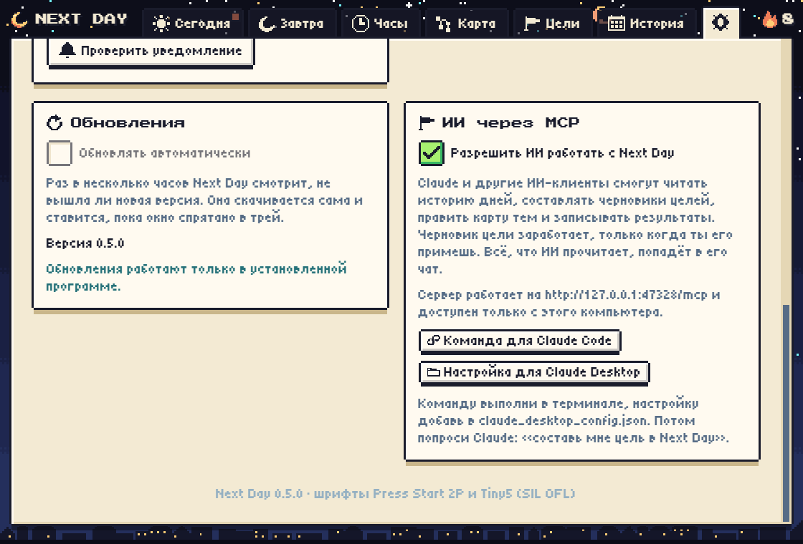

Сервер включается в настройках, в карточке «ИИ через MCP». Там же видно адрес сервера и есть кнопки, которые копируют команду для Claude Code и настройку для Claude Desktop. Команда выглядит так:

```
claude mcp add --scope user --transport http next-day http://127.0.0.1:47328/mcp --header "Authorization: Bearer YOUR_TOKEN"
```

Настройка для Claude Desktop добавляется в `claude_desktop_config.json`:

```json
{
  "mcpServers": {
    "next-day": {
      "command": "C:\\Users\\YOU\\AppData\\Local\\Programs\\Next Day\\Next Day.exe",
      "args": ["--mcp"]
    }
  }
}
```

Путь зависит от папки, которую вы выбрали при установке, поэтому настройку удобнее скопировать кнопкой: она подставит путь к вашей копии. Если переустановите программу в другую папку, скопируйте настройку заново.

После этого попросите ИИ составить цель или набор карточек в Next Day.

<details>
<summary>Справка по MCP</summary>

Эту справку программа отдаёт ИИ-клиентам как ресурс `nextday://guide`. Она написана для ИИ-ассистента и обращается к нему напрямую. Здесь перевод, оригинал на английском есть в английской части.

#### 1. Программа

Next Day это локальный однопользовательский планировщик для Windows, который живёт в трее. Все данные хранятся в JSON-файлах на компьютере пользователя. MCP-сервер работает внутри программы, слушает только 127.0.0.1 и остаётся единственным способом для ассистента прочитать или изменить данные. Всё прочитанное приватно: используйте это только для текущей просьбы пользователя.

Ритм программы:

- Вечер: пользователь называет ЗАВТРАШНИЙ день (тему дня) и может добавить описание и чеклист. Планировать можно только завтра, не дальше. День, который не назвали накануне, можно назвать в тот же день (`namedLate`).
- День: план заморожен, пользователь только отмечает пункты и подпункты.
- Ночь или следующее утро: пользователь собирает итоги на доске (заметки, картинки, сделанные задачи) и запечатывает день оценкой от 1 до 5 и коротким итогом. Запечатанные дни доступны только для чтения.
- Цели: цель это карта тем. Стрелки (требования) показывают, что нужно освоить раньше чего, в каждой теме задачи от простых к сложным. Пока цель активна, программа сама планирует завтрашний день по карте и минутам цели в день. Пользователь видит карту на вкладке «Карта», а цель на вкладке «Цели».
- Зубрилка: короткие карточки подряд, пока не выполнена цель сеанса. Пользователь выбирает, что зубрить (наборы и темы), как (порядок, размер сеанса, самопроверка) и в каких условиях (замок на весь экран или обычное окно, выход, потолок по времени). Своих наборов в программе нет: пользователь собирает их сам, загружает банки или ставит генераторы (плагины на JavaScript), сам или с вашей помощью. Как сравнивать ответ (текст, число, выбор из вариантов, самопроверка, значения и формы Python), задают шаблоны проверки, которые пользователь хранит в группах и может дополнять.

#### 2. Подключение

| Транспорт | Как |
|---|---|
| Streamable HTTP | `POST http://127.0.0.1:{port}/mcp`, порт по умолчанию 47328, заголовок `Authorization: Bearer {token}`. Ответы обычный JSON, без SSE. `GET` возвращает 405, уведомления получают 202. Запросы с чужим `Origin` отклоняются. |
| stdio | Запустите `Next Day.exe --mcp` из папки установки (в сборке для разработки файл называется `next-day.exe`). Мост пересылает строки JSON-RPC в работающую программу, порт и токен берёт из `%APPDATA%\ru.igorberezkin.nextday\mcp.json`. Если программа не запущена, мост всё равно отвечает на рукопожатие, списки и эту справку, а запросы к данным получают ошибку "Next Day is not reachable". |

- Пользователь включает сервер в настройках (карточка «ИИ через MCP»). Карточка показывает адрес и копирует готовые настройки для Claude Code и Claude Desktop.
- Версии протокола: `2026-07-28` (без состояния: `server/discover`, версия в `_meta`) и `2025-11-25`, `2025-06-18`, `2025-03-26` через `initialize`.
- Возможности: инструменты, ресурсы (только чтение), промпты. Сессий, подписок, sampling и уведомлений об изменении списков нет.

#### 3. Время

- Даты в формате `YYYY-MM-DD`, время местное, `YYYY-MM-DDTHH:MM:SS`, без часового пояса.
- Логический день начинается в `dayStartHour` (от 0 до 6). При `dayStartHour` 4 отметка в 01:30 относится к предыдущей дате.
- Берите `now`, `today` и `tomorrow` из `get_overview`, не полагайтесь на свои часы.

#### 4. Модель данных

##### День

Его возвращают `get_history` и `nextday://day/{date}`.

| Поле | Тип | Смысл |
|---|---|---|
| date | дата | |
| name | строка | Тема дня |
| description | строка | Свободный текст, обрезается до 1500 символов |
| namedLate | bool | Назван в тот же день, а не накануне |
| auto | bool | План составила программа по целям, и пользователь его ещё не трогал |
| checklist | Item[] или null | null, если пользователь отказался от чеклиста |
| rating | от 1 до 5 или null | Ставится при печати дня |
| summary | строка или null | До 200 символов, пишется при печати |
| sealed | bool | День запечатан и доступен только для чтения |
| board | string[] | Только с `includeBoard`: текстовые заметки и сделанные задачи с доски итогов, затем `[N image(s)]` |

##### Пункт

| Поле | Тип | Смысл |
|---|---|---|
| id | строка | Непрозрачный идентификатор |
| text | строка | До 300 символов |
| hours | число или null | Оценка, кратна 0.25 |
| start | от 0 до 23 или null | Час начала, виден на вкладке «Часы» |
| done | bool | Отмечен |
| doneAt | время или null | Когда отмечен |
| subs | {text, done}[] | До 3 подпунктов; если отмечены все, отмечается и пункт |
| continues | {date, text} или null | Продолжает задачу из прошлого дня |
| goal | {goalId, taskId} или null | Задача цели, которой соответствует пункт |

В чеклисте не больше 40 пунктов, он всегда отсортирован по часу начала, считая от `dayStartHour`; пункты без времени идут в конце.

##### Цель

| Поле | Тип | Смысл |
|---|---|---|
| id | строка | Непрозрачный идентификатор |
| title | строка | До 80 символов |
| outcome | строка | Конкретный проверяемый итог, до 600 символов |
| note | строка | Контекст: текущий уровень, материалы, ограничения, до 4000 символов |
| deadline | дата или null | |
| minutesPerDay | от 1 до 960 или null | Бюджет на день в минутах задач; null значит 60 |
| days | int[] | Дни недели ISO, от 1 (понедельник) до 7 (воскресенье); пусто значит каждый день |
| startHour | от 0 до 23 или null | Час, с которого в день начинаются задачи цели |
| status | draft, active, paused, done, archived | Меняет только пользователь |
| author | user или ai | Кто создал цель |
| topics | Topic[] | Карта, до 60 тем |
| createdAt, updatedAt | время | |
| progress | Progress | Считается при каждом чтении |
| forecast | планы дней | Следующие 14 рабочих дней так, как их спланирует программа |
| finish | дата или null | Прогноз даты последней задачи; null, если ничего не осталось или остаток никогда не попадёт в план |

##### Тема

| Поле | Тип | Смысл |
|---|---|---|
| id | строка | Внутри программы непрозрачный; в `create_goal` его задаёте вы |
| title | строка | До 120 символов, не повторяется внутри цели |
| note | строка | Материалы, ссылки, подсказки, до 4000 символов |
| requires | string[] | Идентификаторы тем, которые нужны раньше. На карте стрелки идут от них к этой теме |
| tasks | Task[] | До 30, от самой простой к самой сложной |

##### Задача

| Поле | Тип | Смысл |
|---|---|---|
| id | строка | Непрозрачный идентификатор |
| text | строка | До 300 символов |
| minutes | от 1 до 960 или null | Оценка, по ней заполняется бюджет дня; null считается как 30 |
| kind | learn, practice, review, check | `check` это проверка готовности с баллом |
| doneWhen | строка | Проверяемый критерий готовности, до 300 символов |
| status | todo, planned, done, skipped | Смотрите раздел 5 |
| plannedFor | дата или null | День, в плане которого стоит задача (остаётся и после выполнения) |
| doneAt | время или null | |
| result | Result или null | Записанный результат |

- Result: `{minutes, score, confidence, note, at, by}`; minutes от 1 до 1440, score от 0 до 100, confidence от 1 до 5 (каждое может быть null), note до 2000 символов, `by` это user или ai.
- Progress: `{topicsTotal, topicsDone, tasksTotal, tasksDone, tasksLeft, minutesTotal, minutesDone, checksTotal, checksDone, readiness}`. Пропущенные задачи не учитываются. Тема пройдена, когда в ней есть задачи и все они сделаны или пропущены. `readiness` это целое среднее баллов, записанных на проверках; null, если их нет.

##### Набор зубрилки

Наборы бывают трёх видов, и все зубрятся одинаково, через режимы:

- deck: карточки, которые написал пользователь или ИИ через `create_drill_deck`. Поля ниже.
- bank: готовый банк, импортированный из JSON через `import_drill_bank` (DataEater). Каждая карточка это шаблон со множеством вариантов, которые отличаются только данными, например карточки с кодом, ответы к которым получены выполнением кода.
- generator: плагин на JavaScript, который придумывает свежие варианты в начале каждого сеанса; ставится через `install_drill_generator`.

После промаха карточка банка или генератора возвращается другим вариантом: та же задача с новыми данными.

| Поле | Тип | Смысл |
|---|---|---|
| id | строка | Непрозрачный идентификатор |
| title | строка | До 80 символов |
| description | строка | До 1000 символов |
| author | user или ai | |
| check | Check | Как сравнивать ответы на карточки набора, обычно копия шаблона проверки |
| gate | Gate | Если включено, темы открываются по одной |
| cards | Card[] | До 2000 |

##### Карточка

| Поле | Тип | Смысл |
|---|---|---|
| id | строка | Непрозрачный идентификатор |
| topic | строка | Необязательное название раздела, до 80 символов; темы идут в порядке своих первых карточек |
| prompt | строка | Вопрос, до 2000 символов |
| code | строка | Необязательный код, показывается с номерами строк, до 4000 символов |
| answer | строка | Эталонный ответ, его видно после промаха, до 500 символов |
| alternatives | string[] | Другие верные ответы, до 10 |
| choices | string[] | Для выбора из вариантов: сами варианты; ответ добавляется, если его там нет |
| check | Check или null | Своя проверка карточки вместо проверки набора |
| explain | строка | Правило или пояснение после промаха, до 2000 символов |

##### Проверка

`{mode, caseSensitive, ignoreSpaces, tolerance, strictTypes, hint}`

| mode | Ответ верный, когда |
|---|---|
| text | Совпадает после обрезки краёв и схлопывания пробелов; регистр и буквы ё и е не важны, если не задан `caseSensitive`; `ignoreSpaces` убирает все пробелы |
| python | Литерал Python равен ответу вместе с типами (3 и 3.0 различаются, кортеж не список), если `strictTypes` не false; ключи словаря и элементы множества в любом порядке, кавычки любые, пробелы не важны. Имя исключения, например `TypeError`, в кавычках или без, отвечает на код, который падает |
| shape | Запись формы совпадает без учёта пробелов: `int`, `list[str]`, `tuple[str, int]`, `dict[str, list[int]]`, `set[int]` |
| number | Отличается от ответа не больше чем на `tolerance`; запятая работает как десятичная точка |
| choice | Выбран вариант, который и есть ответ |
| self | Пользователь открывает ответ и сам говорит, знал ли его |

`hint` (до 200 символов) показывается под полем ответа во время сеанса вместо стандартной подсказки. Пишите в нём, в каком виде ждут ответ: начальная форма слова, единица измерения, формат даты. Пишите на языке пользователя.

##### Шаблон проверки

`{id, group, name, check}`: проверка с названием, которую пользователь выбирает, когда собирает набор или карточку. Шаблоны лежат в группах, новое название группы создаёт новую группу. Новая установка начинается с двух групп: Основные с `text` (Текст), `choice` (Выбор из вариантов), `number` (Число) и `self` (Самопроверка) и Для программистов с `python` (Значение Python) и `shape` (Форма данных Python). Пользователь может менять и удалять любые шаблоны и вернуть стандартные.

Набор или карточка копирует проверку своего шаблона. Если потом изменить или удалить шаблон, готовые наборы не меняются.

##### Банк

`{id, title, description, gate, topics, cards}`: формат `import_drill_bank`. `id` необязателен: если он свободен (латинские буквы, цифры, `-` и `_`, до 40 символов), банк его сохранит, и прогресс переживёт повторный импорт после удаления банка.

- `topics`: до 100 `{id, title, theory}`. `theory` это Markdown в диалекте программы (смотрите «Статья справочника»), он становится статьёй темы только для чтения. Темы без карточек отбрасываются.
- `cards`: до 2000 `{id, topic, kind, rule, check, variants}`. `id` до 60 символов и не повторяется; `topic` это идентификатор или название темы; `rule` (до 2000 символов) показывается после промаха; `check` может настроить сравнение (caseSensitive, ignoreSpaces, tolerance, strictTypes, hint), а режим всегда берётся из `kind`.
- `variants`: до 200 на карточку и до 100000 на банк, `{question, code, answer, choices, alternatives, explain}`; `prompt` работает как другое имя для `question`. `explain` (Markdown, до 2000 символов) показывается после промаха под правилом: кладите туда разбор именно этих данных, например таблицу всех строк с их результатами.

| kind | Пользователь | answer |
|---|---|---|
| value, python, step | вводит литерал Python | литерал или имя исключения, если код падает |
| pick | выбирает один из 2-8 вариантов, показанных кодом, клавишами a-h | один из `choices`, сравнивается как значения Python |
| shape | вводит форму вида `list[tuple[str, int]]` | форма |
| error | вводит имя исключения | например `TypeError` |
| output | вводит то, что покажет print | напечатанный текст |
| text | вводит текст | текст |
| number | вводит число | число |
| choice | выбирает один из 2-8 текстовых вариантов клавишами a-h | один из `choices` |
| self | открывает ответ и сам себя оценивает | любой текст |

Неправильные варианты отбрасываются и попадают в отчёт импорта; карточка, у которой не осталось вариантов, тоже отбрасывается.

##### Генератор

Обычный скрипт на JavaScript без import и export, который объявляет `plugin`:

```js
const VERBS = [["go", "went", "gone"], ["see", "saw", "seen"]];
const plugin = {
  title: "Неправильные глаголы",
  description: "Формы неправильных глаголов",
  topics: [{ id: "forms", title: "Три формы", theory: "У неправильного глагола три формы: go, went, gone." }],
  templates: [
    {
      id: "past",
      topic: "forms",
      kind: "choice",
      rule: "Past Simple неправильного глагола нужно помнить.",
      make(r) {
        const [base, past, done] = r.pick(VERBS);
        return { prompt: `Past Simple от \`${base}\`?`, answer: past, choices: [past, done, base + "ed", base], explain: `${base}, ${past}, ${done}` };
      },
    },
  ],
};
```

- `plugin.id` необязателен: если он свободен, установленный генератор его сохранит, и прогресс переживёт переустановку.
- Шаблон карточки это `{id, topic, kind, rule, check, make}`. `id` до 60 символов и не должен меняться: по нему хранится прогресс. `kind` берётся из таблицы банка, по умолчанию choice. `make(r)` возвращает один вариант с полями варианта банка.
- `r` это источник случайных чисел с зерном: `r.random()`, `r.int(a, b)` с обоими концами, `r.pick(list)`, `r.chance(p)`, `r.shuffle(list)` (возвращает копию), `r.sample(list, k)`. Используйте его вместо Math.random. Числа в ответах и вариантах становятся строками.
- В начале сеанса программа вызывает `make` до 12 раз на шаблон, убирает повторы и проверяет каждый вариант как вариант банка. Весь прогон должен уложиться в 6 секунд.
- Скрипт работает в изолированном воркере: без сети, без DOM, без доступа к программе и её данным, только вычисления. Глобальная переменная `lang` хранит язык программы, `ru` или `en`: пишите тексты карточек на нём.
- Генератор, установленный или изменённый через MCP, сохраняется выключенным. Пользователь нажимает в программе «Проверить», смотрит примеры карточек и включает его.
- Четыре варианта у карточек choice и pick делайте типичными ошибками именно этой задачи (забыл операцию, взял не ту ось, спутал две похожие функции), а не случайным шумом.

Gate: `{enabled, percent, window}`, по умолчанию 85 и 20. Первая тема открыта всегда; следующая открывается, когда у каждой открытой темы есть хотя бы `window` ответов и не меньше `percent` процентов из последних `window` верные. Пользователь может открывать и закрывать темы и сам.

##### Режим

| Поле | Тип | Смысл |
|---|---|---|
| id | строка | |
| name | строка | До 60 символов |
| sources | `[{deck, topics}]` | Что зубрить; пустой список значит все наборы, пустой `topics` значит открытые темы набора |
| order | smart, random, sequence | smart: интервальное повторение по Лейтнеру (ниже); sequence продолжает с того места, где остановился прошлый сеанс |
| goal | correct, cards, minutes | Сеанс заканчивается после `amount` верных ответов, `amount` ответов или `amount` минут |
| amount | целое | 1-200; для минут 1-180 |
| retry | bool | Карточка с промахом вернётся позже в том же сеансе; карточки банков и генераторов возвращаются с новыми данными |
| explain | bool | Показывать правило и после верных ответов |
| screen | lock, window | lock: на весь экран на каждом мониторе, поверх всех окон, Alt+F4 не работает, фокус возвращается; window: внутри программы, уйти можно в любой момент |
| escape | hold, none | Только для lock: удерживать Esc 5 секунд и подтвердить, это записывается как побег; none: выхода нет, кроме потолка |
| limitMinutes | 5-180 | Только для lock: замок открывается сам через это время (итог timeout) |
| selfCheck | bool | Самопроверка вместо ввода ответа у всех карточек |
| theoryLabel | строка | Подпись кнопки теории, до 24 символов, может быть пустой |
| peekKeepsBox | bool | Карточка, на которую ответили после открытия теории, не поднимается |

- У каждой карточки есть коробка Лейтнера от 1 до 5. Верный ответ при первом показе карточки в сеансе поднимает её на одну коробку, промах отправляет в коробку 1. Следующий показ: коробка 1 в тот же день, коробки 2-5 через 1, 2, 4 и 8 дней. Умный порядок сначала берёт карточки к повтору (сначала из нижних коробок), подмешивает новые и чередует темы; когда повторять нечего, берёт карточки, срок которых ближе всего.
- Итоги сеанса: done (готово), escape (выход из замка по Esc), timeout (сработал потолок замка), stopped (сеанс в окне закончили раньше). Серия зубрилки считает дни подряд с готовым сеансом; побег её обнуляет.
- `theoryLabel` (до 24 символов, может быть пустым) это подпись кнопки с лампочкой, которая открывает теорию во время сеанса. С `peekKeepsBox` (по умолчанию true) карточка, на которую ответили после открытия теории, остаётся в своей коробке и вернётся в тот же день.

##### Статья справочника

| Поле | Тип | Смысл |
|---|---|---|
| id | строка | `{deck}-{topic}` у статей, которые пришли с банками и генераторами |
| deck | строка | Идентификатор набора |
| topic | строка | Идентификатор темы, пусто для всего набора |
| title | строка | До 120 символов |
| body | строка | Markdown, до 100000 символов |
| author | user или ai | |
| builtin | bool | Статья пришла с банком или генератором и доступна только для чтения |

Текст пишется в диалекте Markdown программы: заголовки от `#` до `###`, абзацы, `**жирный**`, `*курсив*`, `` `код` ``, ссылки, списки (`- ` и `1. `, вложенные через два пробела), цитаты `> `, таблицы со строкой `|---|`, линии `---` и блоки кода между тройными обратными кавычками. Особые блоки:

- `data`: по одному элементу в строке, `name = literal`, `literal` или `literal -> literal` (до и после). Программа рисует значение Python картинкой структуры (ячейки списка с индексами, сетка матрицы, пары ключ и значение, кортежи, множества) вместе с его формой. Только литералы: числа, строки, True, False, None, списки, кортежи, словари, множества, set().
- `chart`: JSON `{"type": "line" | "bar" | "scatter", "title", "x": [...], "series": [{"name", "y": [...]}], "xlabel", "ylabel"}`.
- `plot`: строки `y = <выражение от x>` (можно несколько; операторы + - * / ** ^, функции sin cos tan exp log sqrt abs, pi, e), строка диапазона `x = -3..3` и необязательная строка `title: ...`.
- `graph`: рёбра, по одному в строке или через запятую: `a -> b` направленное, `a - b` ненаправленное, `a -> b: 3` с подписью.

Хорошая статья даёт модель, а не список функций: как представить себе данные, пары до и после для главных операций, ловушки и таблицу выражений с их формами.

Во всех текстах, которые читает пользователь (статьи, `explain` карточек, `rule` и `explain` банков и генераторов, вопросы), заключайте каждый кусок кода, имя переменной и значение в обратные кавычки: пишите `a % b` даёт остаток, а не a % b даёт остаток. Программа показывает их плашками кода, и они не сливаются со словами вокруг.

#### 5. Как программа планирует

Статус цели принадлежит пользователю. `create_goal` всегда создаёт черновик. Планируются только активные цели; черновики, цели на паузе, завершённые и архивные не планируются никогда. Никогда не утверждайте, что черновик активен.

Как выбираются задачи одного дня для одной цели:

1. Тема освоена, когда все её задачи сделаны или пропущены. Тема открыта, когда освоены все темы из её `requires`.
2. Темы обходятся в порядке требований; темы, которые не зависят друг от друга, идут в порядке цели.
3. В каждой открытой теме берётся первая несделанная задача по рангу. Задачи добавляются, пока их минуты помещаются в `minutesPerDay`; первая задача дня берётся всегда, даже если она длиннее бюджета.
4. Если в течение дня закрыта последняя задача темы, зависимые темы открываются в тот же день.

План на завтра строится сам и обновляется, пока завтра не началось: после любого изменения цели или карты, после отметок, после печати дня, после изменения настроек и раз в 15 секунд в фоне.

- Если у завтрашнего дня нет плана, программа создаёт его с `auto: true` и называет по темам задач.
- Если пользователь уже спланировал завтра, задачи целей добавляются в его чеклист; его пункты и имя дня остаются.
- Пункты целей пользователь удалить не может. Чтобы освободить день, он ставит цель на паузу, и её пункты уходят из плана на завтра.
- Пункты получают `hours` из минут (с округлением до 0.25) и `start`: задачи цели идут друг за другом от её `startHour`. Если набор задач не меняется, время, которое пользователь поправил сам, сохраняется.
- Пока строится план на завтра, задачи, стоящие на сегодня, считаются сделанными. Если сегодняшний день запечатан с недоделанными задачами целей, они возвращаются в очередь и первыми идут в план на завтра. Если запланированный день прошёл, а задача не сделана, она тоже возвращается в очередь.

Как меняется статус задачи:

| Был | Стал | Когда |
|---|---|---|
| todo | planned | Программа поставила задачу в план на завтра |
| planned | done | Пользователь отметил пункт, или пришёл `record_result` со статусом done |
| planned | todo | Запланированный день прошёл или запечатан без неё, или цель перестала быть активной |
| done | planned | Пользователь снял отметку |
| любой | todo, done, skipped | `record_result` со статусом; planned ставит только программа |

#### 6. Инструменты

Каждый инструмент возвращает `structuredContent` и тот же JSON текстом. Ошибки инструментов приходят с `isError: true` и коротким сообщением на языке программы, русском или английском. Прочитайте их и исправьте вызов, а не повторяйте тот же самый.

##### get_overview (чтение)

Без аргументов. Возвращает `{now, today, tomorrow, dayStartHour, eveningTime, todayPlan, tomorrowPlan, goals}`.

- `todayPlan`, `tomorrowPlan`: null или `{date, name, auto, sealed, checklist}`, где пункты имеют вид `{text, start, hours, done, goal}`, а `goal` это `{goalId, taskId}` или null.
- `goals`: активные цели, черновики и цели на паузе в виде `{id, title, status, deadline, minutesPerDay, progress, finish, nextDay: {date, tasks: [{topic, task}]}}`.

##### get_profile (чтение)

`days`: окно от 7 до 180, по умолчанию 42. Статистика по завершённым дням до сегодняшнего; если история короче, окно начинается с первого дня с данными.

Возвращает `{windowDays, from, to, daysCovered, daysPlanned, planningRate, daysWithChecklist, medianPlannedHours, medianDoneHours, maxDoneHours, itemsPlanned, itemsDone, itemCompletion, avgRating, streak, bestStreak, startHourHistogram, doneHourHistogram, mostActiveHours, weekdays, settings, notes}`.

- Часы берутся из оценок пользователя: запланированные часы дня это сумма по всем пунктам, сделанные это сумма по отмеченным. Это не измеренное время.
- `planningRate` это `daysPlanned / daysCovered`.
- `startHourHistogram[h]`: пункты, которые начинаются в час h. `doneHourHistogram[h]`: пункты, отмеченные в течение часа h. `mostActiveHours`: до четырёх часов с наибольшим числом отметок.
- От `weekdays.mon` до `weekdays.sun`: `{plannedDays, avgDoneHours, completion}`.
- `streak`, `bestStreak`: серии подряд идущих дней, с которыми пользователь работал; нетронутые автоматические планы не считаются.

##### get_history (чтение)

`from`, `to` (обязательны), `includeBoard` (по умолчанию false). Не больше 62 дней; `to` ограничивается завтрашним днём. Возвращает `{from, to, today, days}`, только дни с планом, каждый в виде Дня.

##### list_goals (чтение)

`status`: необязательный фильтр. Возвращает `{goals}`; у каждой цели её настройки, `progress`, `finish` и краткая карта `{id, title, requires, tasks, done}` по каждой теме, где `tasks` и `done` это количества.

##### get_goal (чтение)

`goalId`. Возвращает цель целиком: все темы и задачи со статусами и результатами, `progress`, `finish` и `forecast` в виде `[{date, minutes, tasks: [{taskId, topic, text}]}]`.

##### create_goal (запись)

Обязательные поля: `title`, `outcome`, `topics`. Необязательные: `note`, `deadline`, `minutesPerDay`, `days`, `startHour`. Тема это `{id, title, note, requires, tasks}`, задача это `{text, minutes, kind, doneWhen}`.

- Дайте каждой теме свой короткий `id` (латинские буквы, цифры, `-` и `_`) и используйте эти идентификаторы в `requires`. Точные названия тоже подходят.
- Сначала проверяется весь ввод: неизвестные требования, ссылки темы на саму себя, циклы и одинаковые названия отклоняются, и тогда ничего не сохраняется.
- Создаёт черновик с `author: ai` и возвращает `{goal, note}`; `goal.finish` и `goal.forecast` сразу показывают, как карта ложится в бюджет.

##### update_goal (запись)

`goalId` и любые из `title`, `outcome`, `note`, `deadline`, `minutesPerDay`, `days`, `startHour`. Пропущенные поля не меняются; `deadline: ""` убирает срок. Статус не меняется никогда. Возвращает цель целиком; план на завтра пересчитывается.

##### edit_topics (запись)

`goalId`, `upsert` (темы, которые нужно добавить или изменить), `remove` (идентификаторы тем, которые нужно удалить). Нужно хотя бы одно из двух.

- Запись в `upsert` с существующим `id` меняет только переданные поля. Без `id` или с незнакомым `id` добавляется новая тема, и тогда нужен `title`.
- `tasks`, если передан, заменяет весь ранжированный список задач темы. Передавайте существующие задачи с их `id`, чтобы сохранить статус и результат; пропущенные задачи удаляются, кроме сделанных, они остаются наверху.
- `requires`, если передан, заменяет требования. Подходят идентификаторы и точные названия, в том числе тем, добавленных в этом же вызове.
- Удаление темы удаляет её задачи вместе со сделанными и убирает её из `requires` других тем.
- Возвращает цель целиком; план на завтра пересчитывается.

##### record_result (запись)

`goalId`, `taskId` и любые из `status` (todo, done, skipped), `minutes` (от 1 до 1440), `score` (от 0 до 100), `confidence` (от 1 до 5), `note` (до 2000 символов).

- Если передано хотя бы одно поле результата, результат задачи заменяется переданными значениями.
- Если передан только `status`, меняется статус, а записанный результат остаётся.
- Статус done также отмечает пункт этой задачи в открытом плане на сегодня или на вчера.
- Записывайте баллы на задачах-проверках, чтобы они шли в готовность.
- Перед записью спросите пользователя или проверьте работу. Возвращает краткий вид цели.

##### get_drill (чтение)

Без аргументов. Возвращает `{presets, checks, defaultPreset, decks, streak, bestStreak, today, due, weak, sessions}`.

- `checks`: шаблоны проверки в том порядке, в каком их видит пользователь, `{id, group, name, check}`.
- `decks`: `[{id, title, description, kind, enabled, author, cards, variants, check, gate, topics, updatedAt}]`; `kind` это deck, bank или generator, `cards` у генератора считает его шаблоны карточек, `variants` считает готовые варианты банка, `enabled` равно false у генератора, который ждёт проверки пользователем. `topics` это `{id, title, cards, open, answered, recent, recentRight, seen, due, boxes}`. `recentRight` из `recent` это точность в окне порога; `boxes` считает показанные карточки по коробкам Лейтнера.
- `today`: `{sessions, answers, correct}`. `due`: карточки к повтору в основном режиме.
- `weak`: карточки с наибольшим числом промахов `{deck, card, topic, prompt, code, answer, rule, right, wrong, level, lastWrong}`. В `lastWrong` последние неверные ответы пользователя, лучшая подсказка, где ошибка в понимании.
- `sessions`: последние 40, сначала новые, `{name, startedAt, endedAt, outcome, screen, goal, amount, answered, correct, firstTry, wrong, seconds, misses}`.

##### get_drill_deck (чтение)

`deckId`. Набор пользователя со всеми карточками. Генератор возвращает `{kind: generator, title, description, author, enabled, topics, templates, code}`. Банк возвращает `{kind: bank, topics, cards}`, где каждая карточка это шаблон `{id, topic, kind, rule, variants, sample}`; kind бывает value (ввести литерал), pick (выбрать один из четырёх литералов: верный и три типичные ошибки в структуре), shape (ввести форму), step (значение после k-го прохода цикла), error (код падает, ввести имя исключения) или output (что покажет print). После промаха пользователь получает тот же шаблон с новыми данными.

##### create_drill_deck (запись)

Обязательные поля: `title`, `cards`. Необязательные: `description`, `check` или `template`, `gate`. Каждой карточке нужны `prompt` и `answer`, у неё может быть свой `check` или `template`.

- `template` это идентификатор или название шаблона проверки из `get_drill`; его проверка копируется в набор или в карточку. Если подходящий шаблон есть, берите его, а не собирайте `check` вручную.
- Сначала проверяется весь ввод: в режиме python каждый ответ и альтернатива должны быть литералом или именем исключения, в режиме number числом; у карточек с выбором нужно хотя бы два варианта.
- Создаёт набор с `author: ai` и возвращает `{deck, note}`. Набор зубрится только после того, как его добавят в режим.

##### edit_drill_deck (запись)

`deckId` и любые из `title`, `description`, `check` или `template`, `gate`, `upsert` (карточки; карточка с существующим `id` заменяется, без `id` добавляется) и `remove` (идентификаторы карточек). Банки и генераторы меняются через `import_drill_bank` и `install_drill_generator`. Прогресс оставшихся карточек сохраняется. Возвращает набор.

##### get_drill_theory (чтение)

Необязательный `deckId`; вместе с ним `topic` (идентификатор темы) сужает список до этой темы и статей обо всём наборе. Возвращает `{articles}`: `[{id, deck, topic, title, body, author, builtin, createdAt, updatedAt}]`. Статьи, которые пришли с темами банков и генераторов, имеют `builtin: true`.

##### save_drill_theory (запись)

`deckId`, `title`, `body`, необязательные `topic` (идентификатор или название, пусто для всего набора) и `id` (заменяет эту статью). Создаёт статью с `author: ai`. Статьи банков и генераторов менять нельзя; пишите свои рядом с ними. Возвращает статью.

##### install_drill_generator (запись)

`title`, `code`, необязательные `description` и `id` (заменяет код этого генератора или, если свободен, становится идентификатором нового). Сохраняет генератор выключенным и возвращает `{generator: {id, title, enabled}, note}`. Программа запускает скрипт только после того, как пользователь проверит и включит его; потом добавьте его в режим.

##### import_drill_bank (запись)

`bank` (сам объект) или `path` (абсолютный путь к файлу .json до 16 МБ), необязательный `replaceId` (импортированный банк, который нужно заменить; прогресс карточек с теми же идентификаторами сохраняется). Возвращает `{report: {id, title, topics, cards, variants, dropped, problems, replaced}, note}`. Прочитайте `problems`: там названы отброшенные карточки и варианты и причины.

##### save_drill_check (запись)

`name` (до 60 символов), `check`, необязательные `group` (до 40 символов, по умолчанию Свои) и `id` (заменяет этот шаблон). Новое название группы создаёт группу; новый шаблон встаёт в конец своей группы. Возвращает шаблон.

##### delete_drill_check (запись)

`id` удаляет один шаблон, `group` удаляет всю группу. Наборы сохраняют свои копии проверки. Возвращает `{deleted}`.

##### save_drill_preset (запись)

Любые поля режима и `makeDefault`. Без `id` режим создаётся из значений по умолчанию (все наборы, 10 верных ответов, умный порядок, повтор промахов, замок с выходом по Esc и потолком 30 минут); с `id` меняются только переданные поля. Возвращает режим.

- Сеансы запускает только пользователь, в программе.
- Никогда не включайте `screen: lock` и не ставьте `escape: none`, если пользователь сам не попросил об этом своими словами.

#### 7. Ресурсы и промпты

| URI | Содержимое |
|---|---|
| nextday://guide | Эта справка (на английском) |
| nextday://goals | То же, что `list_goals` |
| nextday://profile | `get_profile` за 42 дня |
| nextday://goal/{goalId} | То же, что `get_goal` |
| nextday://day/{date} | Один день с планом и заметками с доски |
| nextday://drill | То же, что `get_drill` |

Промпты: `plan_goal(goal, deadline?)`, `evening_review()`, `readiness_check(goalId)`, `drill_coach()`. Каждый возвращает одно сообщение от имени пользователя, которое запускает соответствующий сценарий ниже.

#### 8. Сценарии

##### Составить карту цели

1. Прочитайте `get_overview`, `get_profile` с `days` от 42 до 60 и `get_history` за последние две или три недели.
2. Опишите реальный ритм пользователя в двух или трёх предложениях: частоту планирования, `medianDoneHours`, активные часы, сильные и слабые дни недели.
3. Спросите то, чего не можете знать: итог и срок, текущий уровень по каждой теме, материалы, удобные дни и часы. Не придумывайте уровень пользователя.
4. Считайте бюджет по фактам. `medianDoneHours` это то, что пользователь на самом деле успевает за день, а другим делам тоже нужно время, поэтому цели обычно достаётся от 30 до 50% этого. Если пользователь хочет больше, покажите, что говорят данные, и дайте ему решить.
5. Ставьте `startHour` внутри `mostActiveHours`; тяжёлую учёбу не ставьте поздно, если история не говорит обратного. Разным целям давайте разные часы начала.
6. Постройте карту:
   - Тема это один навык или область знаний на несколько дней работы, обычно от 3 до 10 задач.
   - В `requires` только то, что действительно нужно знать раньше. Не добавляйте стрелки на всякий случай: каждая стрелка откладывает зависимую тему.
   - Внутри темы от простого к сложному: сначала учёба, потом практика, повторение и проверка, если тема важна для итога.
   - В конце финальная тема, которая требует ключевые темы и содержит проверку, похожую на настоящую цель.
   - У каждой задачи должны быть минуты, у практики и проверок ещё и проверяемый `doneWhen`.
7. Посмотрите на `finish` в ответе. Если он не попадает в срок, скажите об этом и предложите карту поменьше, бюджет побольше или срок позже, затем внесите выбранное через `update_goal` или `edit_topics`.
8. Подведите итог: темы, время в день, прогноз окончания. Попросите пользователя посмотреть вкладку «Карта» и включить цель на вкладке «Цели».

##### Вечерний разбор

1. Вызовите `get_overview` и прочитайте сегодняшний день через `get_history` или `nextday://day/{today}`.
2. По каждому пункту цели за сегодня спросите, как прошло. Задайте короткий опрос (от двух до пяти вопросов, по одному) или проверьте работу; запустите тесты пользователя, если у вас есть доступ к терминалу.
3. Вызовите `record_result` по каждой задаче с минутами, баллом и короткой заметкой. Отмечайте задачу сделанной, только когда выполнен её `doneWhen`.
4. Если было трудно, добавьте в тему задачи на повторение или практику через `edit_topics` (передайте весь список задач с существующими идентификаторами и новыми задачами на нужных местах). Если пользователь опережает план, скажите об этом.
5. Расскажите, что стоит в плане на завтра по целям; это видно в `tomorrowPlan`.

##### Проверка готовности

1. Вызовите `get_goal` и прочитайте итог и освоенные темы.
2. Придумайте проверку, похожую на настоящую цель (ограничение по времени, задания, критерии оценки), проведите её в чате по частям и честно оцените.
3. Вызовите `record_result` с баллом на задаче-проверке; если такой нет, добавьте её через `edit_topics`.
4. Назовите, что исправить в первую очередь, и добавьте задачи на повторение в самые слабые темы.

##### Перестроить карту

- Чтобы вставить работу, передайте весь список задач темы в новом порядке с существующими идентификаторами.
- Чтобы поставить тему между двумя другими, добавьте её и обновите `requires` тем, которые от неё зависят.
- Не удаляйте темы со сделанной работой: их сделанные задачи пропадут. Лучше добавляйте задачи или темы.

##### Тренер зубрилки

1. Вызовите `get_drill`. Назовите открытые темы, точность, серию и итоги последних сеансов; побеги и истёкшее время значат, что сеансы слишком длинные или слишком трудные.
2. Изучите `weak`: сгруппируйте промахи по правилу, которое за ними стоит, и прочитайте `lastWrong`, чтобы найти ошибку в понимании.
3. Объясните каждое правило на крошечном примере и проверьте пользователя в чате, по одному вопросу за раз.
4. Предложите набор против этих ошибок: создайте его через `create_drill_deck` (подходящий шаблон проверки из `checks`, python для вопросов про код, короткий `explain` у каждой карточки) и, если пользователь согласен, добавьте его в режим через `save_drill_preset`. Если пользователь будет снова зубрить ответы одного вида (слова языка, даты, формулы), предложите для них шаблон проверки через `save_drill_check` с `hint`, который называет ожидаемую форму ответа.
5. Если правило продолжает подводить, запишите модель на будущее через `save_drill_theory` в этом наборе и теме: короткую статью с блоками `data`, которые показывают структуру до и после.
6. Если пользователю снова и снова нужна задача одного вида с новыми данными (формы после преобразований, формы глаголов, перевод единиц), напишите генератор вместо набора. Смотрите ниже.

##### Написать генератор

1. Договоритесь с пользователем о задаче: что показывается, о чём спрашивается, какие ошибки стоят за неверными вариантами, и о темах.
2. Напишите скрипт. Данные держите маленькими и читаемыми: задача должна тренировать узнавание структуры, а не устный счёт. Кладите в каждый вариант пошаговый `explain`.
3. Проверьте его до установки: загрузите скрипт в node (`new Function(code + "; return plugin")()`), вызовите каждый `make` несколько сотен раз с `r` с зерном, как описано выше, и проверьте, что ответ есть среди вариантов, варианты не повторяются, а тексты укладываются в лимиты. Если ответы получаются из кода (Python, NumPy, PyTorch), выполните этот код и сравните.
4. Установите его через `install_drill_generator`, затем попросите пользователя открыть Зубрилку, вкладку «Наборы», нажать «Проверить», посмотреть примеры карточек и включить генератор.
5. Предложите режим с ним через `save_drill_preset`, например сеанс в окне на 10 карточек.

#### 9. Соглашения

- Программа работает на русском или английском, как выбрал пользователь в настройках; названия вкладок и кнопок в справке следуют этому языку.
- Пишите тексты цели на языке пользователя; ориентируйтесь на имена его дней и пункты чеклистов.
- Тексты это обычный текст. Ссылки и пути Windows в программе становятся кликабельными.
- Идентификаторы это непрозрачные строки; берите их из ответов инструментов, кроме идентификаторов тем, которые вы задаёте в `create_goal`.
- Задачи пишите конкретно и коротко: «Решить 3 задачи на скользящее окно», а не «Поучить алгоритмы».
- Любая запись сразу видна в открытой программе.

</details>

### Установка

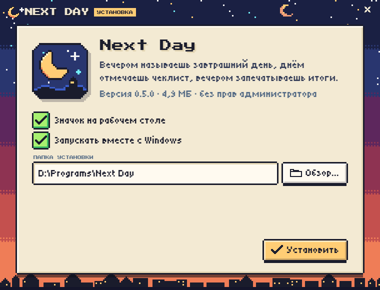

Скачайте установщик из раздела Releases и запустите. Права администратора не нужны, папку можно выбрать, ярлык на рабочем столе и автозапуск включаются галочками. Новые версии программа ставит сама, пока окно спрятано в трей. Автообновление можно выключить в настройках. Удалить программу можно через «Приложения» Windows.

### Сборка

Нужны Node.js и Rust.

```
npm install
npm run release
```

Установщик появится в `release/NextDaySetup.exe`.

Если есть ключ подписи `~/.tauri/next-day.key`, рядом появится `latest.json`. Его нужно приложить к релизу вместе с установщиком, тогда установленные программы обновятся сами.

Запуск для разработки:

```
npm run tauri dev
```

### Лицензия

MIT

</details>

<details>
<summary><b>English</b></summary>

## Next Day

A planner for one day ahead, for Windows. In the evening you name the next day and decide what you will do. During the day you tick what is done, and in the evening you collect the results and seal the day. Big goals are split into topics, and the app puts their tasks into your plan by itself. The drill trainer works for any subject that fits into questions and answers, from foreign words to driving test questions. The app starts with Windows, lives in the tray and reminds you about the plan in the morning and in the evening.

Only the next day can be planned, one plan per day. The interface is in English and Russian, and the language is switched in the settings.

### Plan for tomorrow

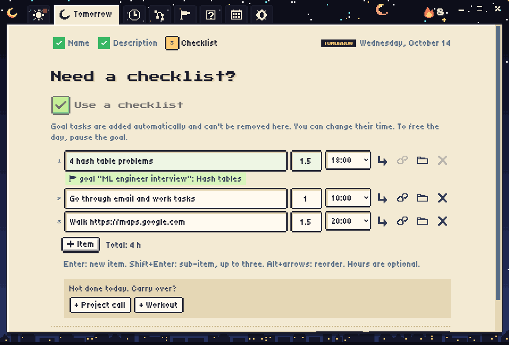

In the evening a three-step wizard asks for the name of the next day, a description and a checklist. An item can have hours, a start hour and up to three sub-items, a file can be attached to it, and it can continue a task from an earlier day. Items you did not finish today move to tomorrow with one click. Goal tasks are already in the plan and shown in green: you can change their time, but you can not delete them.

### Today

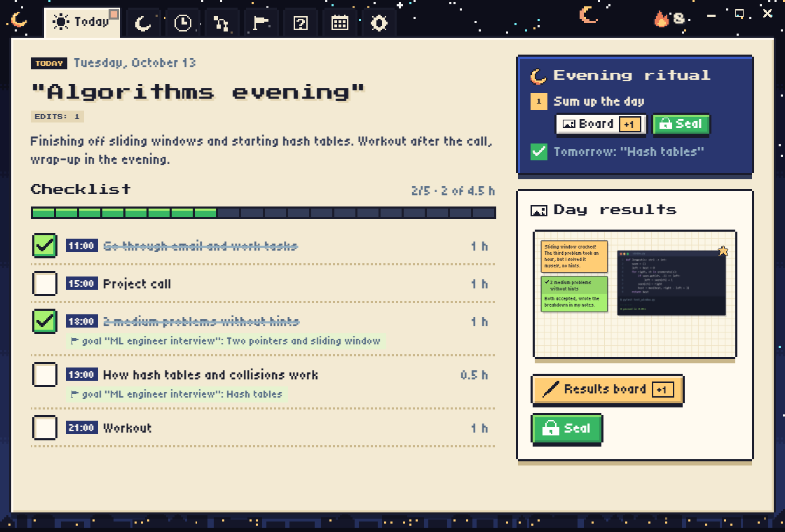

In the morning the plan from the evening becomes the plan for today. It can not be changed any more, you only tick the items. Goal items have a flag, and a click on it opens the topic on the map. In the evening a ritual card on the right reminds you to collect the results and shows the plan for tomorrow.

### Results board

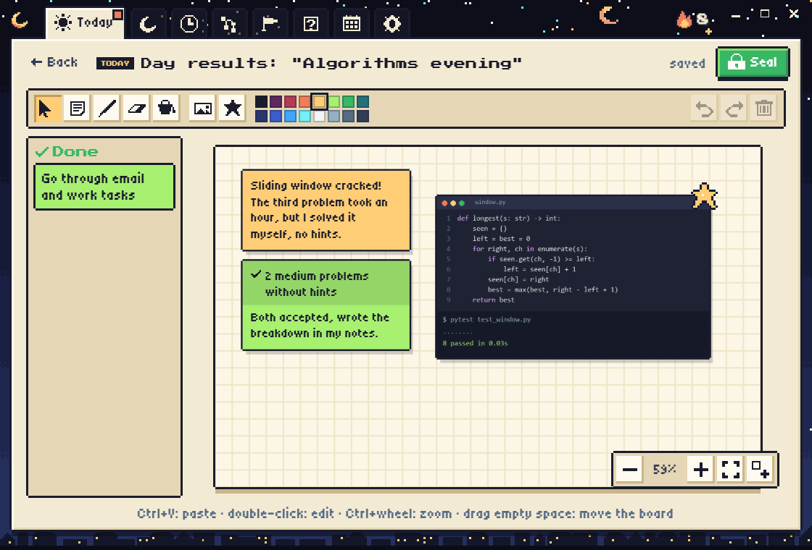

The board holds the results of the day. Finished items wait on the left and become cards, and you can paste screenshots, write notes, draw and add stickers. When the results are ready, you seal the day with a rating from 1 to 5. A sealed day stays in the history and can not be changed.

### Clock

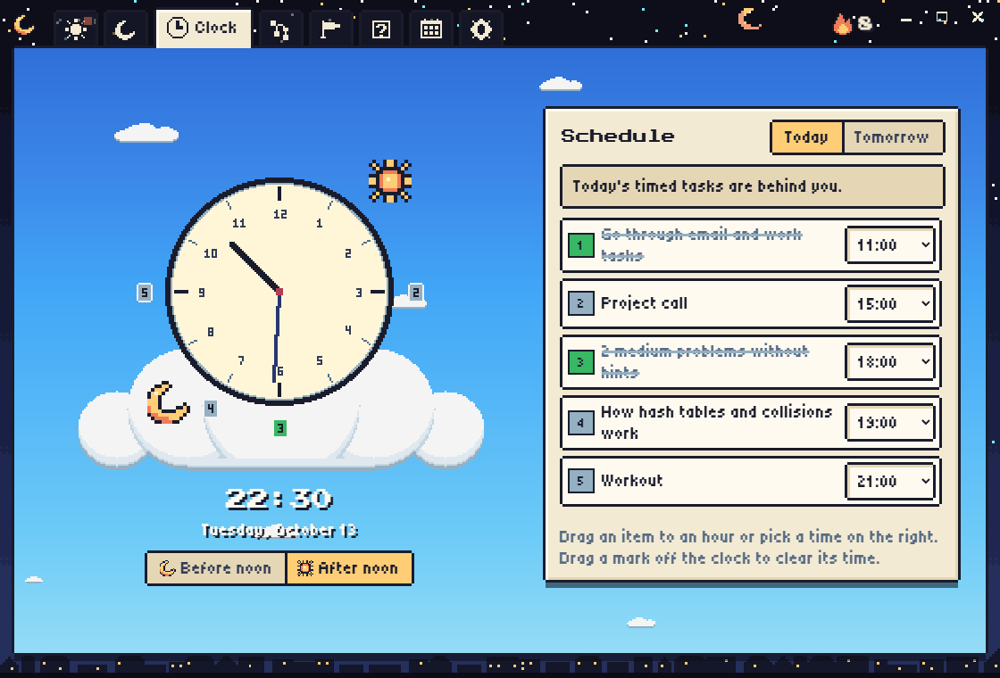

The Clock tab shows the tasks with a start hour right on the clock face. Drag an item to an hour or pick the hour in the list on the right. When the hour comes, the app reminds you. The switch below shows the hours before noon or after noon.

### History

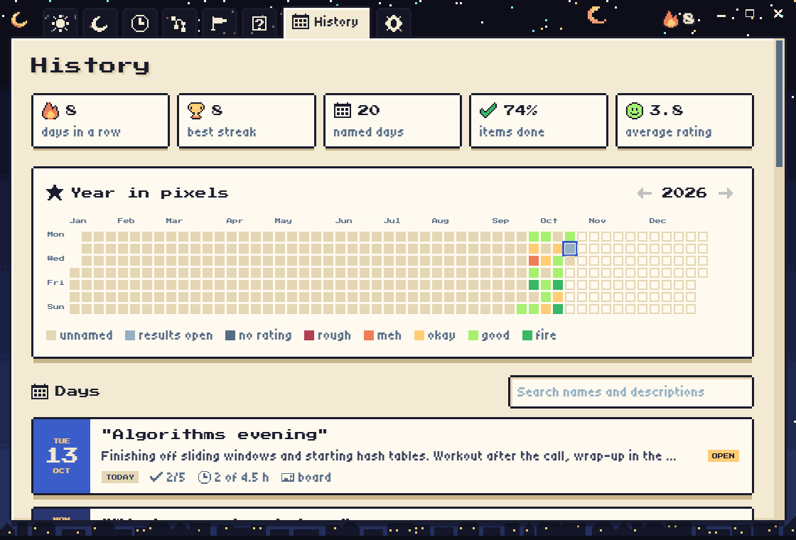

At the top you see your streak of days, the share of finished items and the average rating. The year in pixels colors every day by its rating. Below is the list of all days with a search by names and descriptions, and any day opens with its plan and its board.

### Goals

A big goal can be split into topics: what you need to know and in which order. Each topic has its own tasks, from simple to hard, and each task has an estimated time. While a goal is active, Next Day puts its next tasks into the plan for the next day, as many as fit into the time you give the goal per day. If the next day has no plan yet, the app creates one, and you can rename it and add your own items. Ticks move the goal forward, and unfinished tasks come back into the plan. To skip some days, pause the goal.

#### Goal map

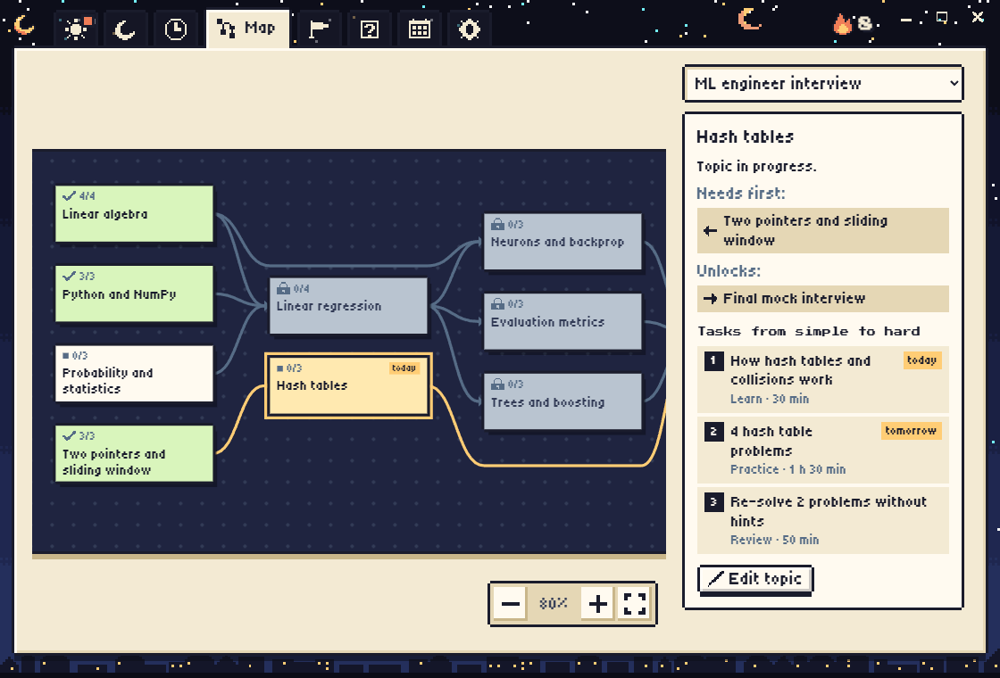

The Map tab shows a goal as a graph. An arrow goes from a topic you need to know to the topic that needs it, and the goal itself is on the right. Green topics are done, yellow ones are in progress, light ones are open, and gray ones stay closed until the topics before them are done. Click a topic to see its tasks from simple to hard on the right, with marks for today and tomorrow. There you can tick a task, record a result or skip it. Topics, arrows and tasks can be added and edited right on the map.

#### Goal

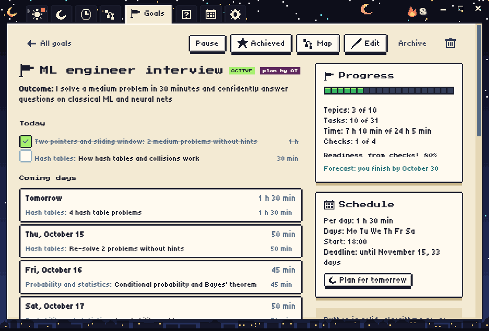

The Goals tab shows what is planned for today and what the app will plan for the next days. On the right you see the progress by topics and tasks, the readiness from checks and a forecast that tells you if you will finish before the deadline. The settings set the time per day, the weekdays, the start hour and the deadline. The buttons at the top pause the goal, finish it or open its map.

### Drill trainer

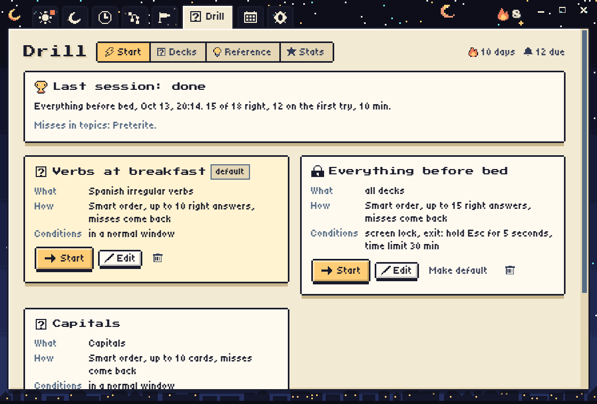

The drill trainer works for any subject you can split into questions and answers: foreign words, chemistry, driving test questions, history dates, terms for an exam. You build decks yourself, load ready ones from a file or ask an AI to make them. Cards come one after another until the session goal is met: a number of right answers, of cards or of minutes. A mode sets what to drill and how. A session runs in the normal window or behind a full screen lock: you leave the lock only by holding Esc for five seconds, or when the time is up. The streak counts the days in a row with a finished session.

#### Cards

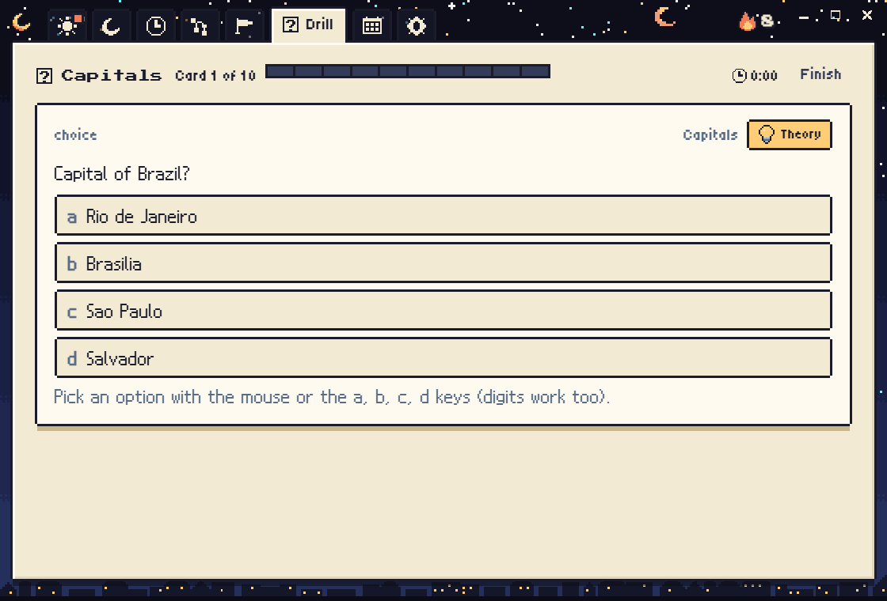

You type the answer as text or a number, pick it from options with the mouse or the keys, or recall it, reveal the answer and honestly mark whether you knew it. After a miss you see the right answer and an explanation, and the card comes back later in the same session. A right answer moves the card further away: it comes back after a day, then after two, four and eight days. Topics of a deck can open one by one: the next one opens when the open ones reach the share of right answers you set.

#### Decks

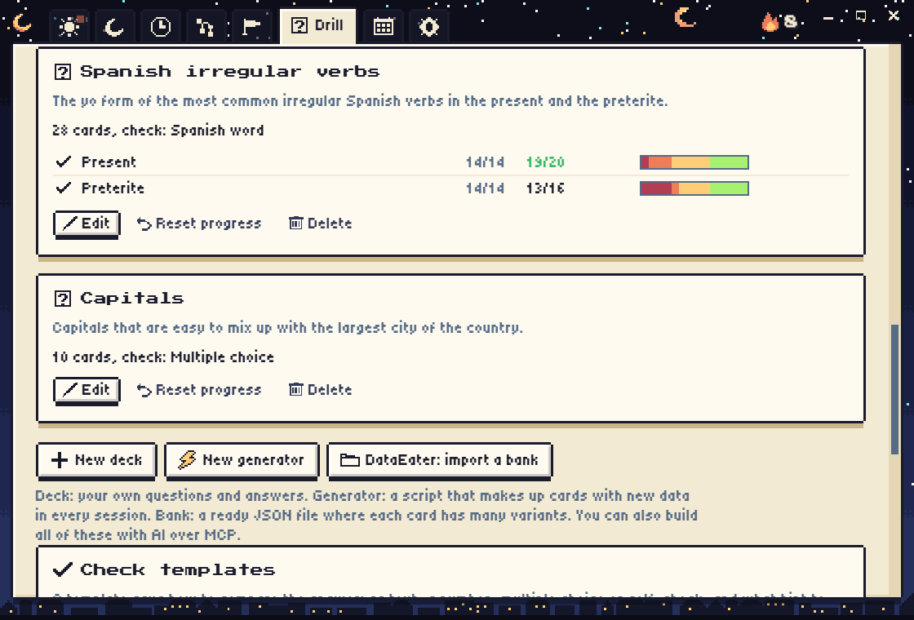

You build your own decks right in the app: a question, an answer, other accepted answers, options to choose from and an explanation for a miss. Many cards can be pasted at once, one per line. A check template says how to compare the answer: as text, as a number, as a choice of options or by self-check. A template can also show a hint under the answer field about the form of the answer. Templates live in groups, and you can create your own templates and groups for any subject.

When a task has to be solved again and again with new data, a generator works better than a deck: a JavaScript script that makes new cards for every session. A generator runs in a sandbox without access to the network and to your data, and it is turned on only after you look at its sample cards. Ready banks of cards in JSON are loaded with the DataEater button.

#### Reference

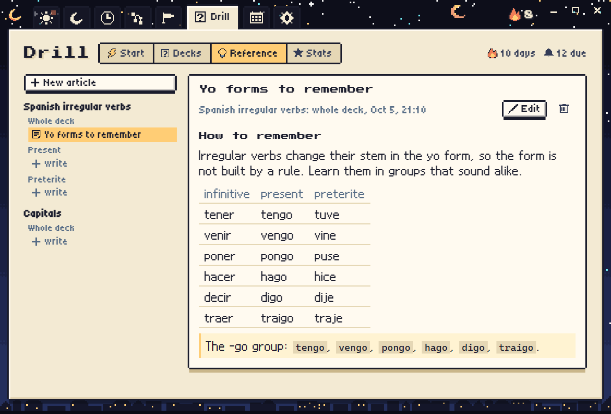

The reference holds articles for decks and their topics: rules, tables, diagrams and charts. Write an article yourself or ask an AI. During a session it opens with the lightbulb button.

### AI over MCP

You can build the goal map yourself or ask an AI to do it. The app has a built-in MCP server. Through it Claude Code, Claude Desktop or any other MCP client can read your day history, create a draft goal, change the map and record results. It can also build a drill deck, write an article for the reference, make a generator or a check template and go through your misses with you. The server can be reached only from your own computer, and only with a token.

#### Draft from AI

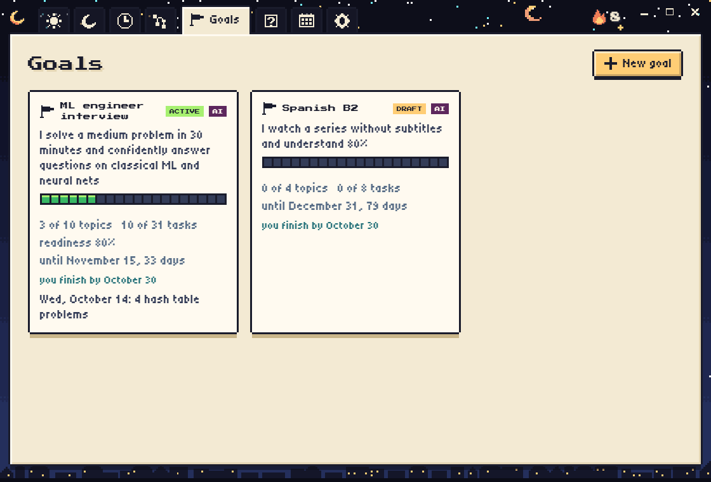

A goal made by an AI has the AI mark and starts as a draft. It starts to work only after you open it, look at the map and press the button to accept and start it.

#### Settings

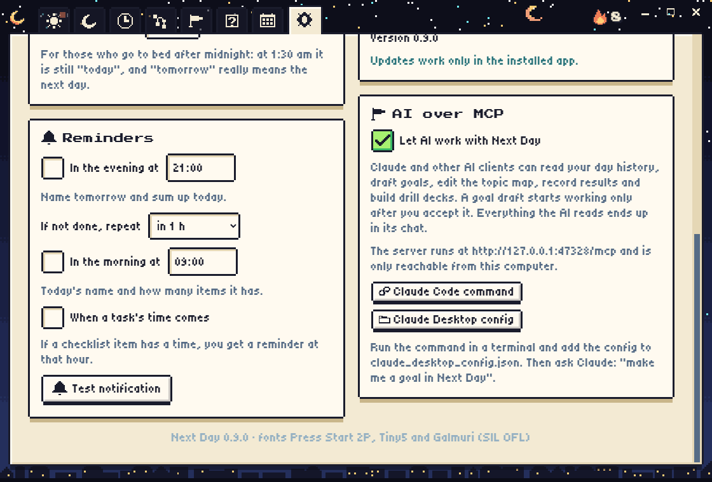

Turn the server on in the settings, in the card for AI over MCP. The card shows the server address and has buttons that copy a ready command for Claude Code and a ready config for Claude Desktop. The command looks like this:

```
claude mcp add --scope user --transport http next-day http://127.0.0.1:47328/mcp --header "Authorization: Bearer YOUR_TOKEN"
```

The config for Claude Desktop goes into `claude_desktop_config.json`:

```json
{
  "mcpServers": {
    "next-day": {
      "command": "C:\\Users\\YOU\\AppData\\Local\\Programs\\Next Day\\Next Day.exe",
      "args": ["--mcp"]
    }
  }
}
```

The path depends on the folder you chose during installation, so it is easier to copy the config with the button: it fills in the path to your copy. If you reinstall the app into another folder, copy the config again.

After that, ask the AI to make a goal or a drill deck in Next Day.

<details>
<summary>MCP reference</summary>

This is the reference the app gives to AI clients as the resource `nextday://guide`. It is written for AI assistants, so it addresses the assistant directly.

#### 1. The app

Next Day is a local, single-user day planner for Windows that lives in the tray. All data is stored as JSON files on the user's computer. This MCP server runs inside the app, listens on 127.0.0.1 only and is the only way for an assistant to read or change the data. Everything you read is private: use it only for the user's current request.

The rhythm of the app:

- Evening: the user names TOMORROW (the theme of the day) and may add a description and a checklist. Only tomorrow can be planned, never further ahead. A day that was not named the evening before can still be named on the day itself (`namedLate`).
- Day: the plan is frozen; the user only ticks checklist items and sub-items.
- Night or next morning: the user collects results on a board (notes, images, finished tasks) and seals the day with a rating 1-5 and an optional short summary. Sealed days are read-only history.
- Goals: a goal is a map of topics. Arrows (prerequisites) say what must be mastered before what; every topic holds tasks ranked from simple to hard. While a goal is active, the app plans tomorrow by itself from the map and the goal's daily minutes. The user sees the map on the Map tab and the goal on the Goals tab.
- Drill trainer (tab Drill): short cards answered in a row until a session goal is met. The user chooses what to drill (decks and topics), how (order, session size, self-check) and under which conditions (a full-screen lock or a normal window, an escape, a time ceiling). The app has no decks of its own: the user builds them, imports banks or installs generators (JavaScript plugins), by hand or with your help. How answers are compared (text, a number, a choice of options, self-check, Python values and shapes) comes from check templates that the user keeps in groups and can extend.

#### 2. Connecting

| Transport | How |
|---|---|
| Streamable HTTP | `POST http://127.0.0.1:{port}/mcp`, default port 47328, header `Authorization: Bearer {token}`. Responses are plain JSON, never SSE. `GET` returns 405, notifications return 202. Requests with a foreign `Origin` are rejected. |
| stdio | Run `Next Day.exe --mcp` from the install folder (`next-day.exe` in development builds). The bridge relays JSON-RPC lines to the running app, reading the port and token from `%APPDATA%\ru.igorberezkin.nextday\mcp.json`. When the app is not running, the bridge still answers the handshake, the lists and this guide; data calls fail with "Next Day is not reachable". |

- The user turns the server on in Settings (card "AI over MCP"). The card shows the URL and copies ready-made setups for Claude Code and Claude Desktop.
- Protocol versions: `2026-07-28` (stateless: `server/discover`, version in `_meta`) and `2025-11-25`, `2025-06-18`, `2025-03-26` through `initialize`.
- Capabilities: tools, resources (read only), prompts. No sessions, subscriptions, sampling or list-change notifications.

#### 3. Time

- Dates are `YYYY-MM-DD`; timestamps are local `YYYY-MM-DDTHH:MM:SS` without a zone.
- The logical day starts at `dayStartHour` (0-6). With `dayStartHour` 4, a tick at 01:30 belongs to the previous date.
- Take `now`, `today` and `tomorrow` from `get_overview`; do not rely on your own clock.

#### 4. Data model

##### Day

Returned by `get_history` and `nextday://day/{date}`.

| Field | Type | Meaning |
|---|---|---|
| date | date | |
| name | string | Theme of the day |
| description | string | Free text, clipped to 1500 chars |
| namedLate | bool | Named on the day itself, not the evening before |
| auto | bool | The app made this plan from goals and the user has not touched it yet |
| checklist | Item[] or null | null when the user chose no checklist |
| rating | 1-5 or null | Set when the day is sealed |
| summary | string or null | Up to 200 chars, written when sealing |
| sealed | bool | Read-only history when true |
| board | string[] | Only with `includeBoard`: text notes and finished tasks from the results board, then `[N image(s)]` |

##### Item

| Field | Type | Meaning |
|---|---|---|
| id | string | Opaque |
| text | string | Up to 300 chars |
| hours | number or null | Estimate, a multiple of 0.25 |
| start | 0-23 or null | Planned start hour, shown on the clock tab |
| done | bool | Ticked |
| doneAt | timestamp or null | When it was ticked |
| subs | {text, done}[] | Up to 3 sub-items; ticking all of them ticks the item |
| continues | {date, text} or null | Continues a task from an earlier day |
| goal | {goalId, taskId} or null | The goal task this item stands for |

A checklist holds at most 40 items and is always sorted by start hour counted from `dayStartHour`; items without a start come last.

##### Goal

| Field | Type | Meaning |
|---|---|---|
| id | string | Opaque |
| title | string | Up to 80 chars |
| outcome | string | Concrete, checkable definition of success, up to 600 chars |
| note | string | Context: current level, materials, constraints, up to 4000 chars |
| deadline | date or null | |
| minutesPerDay | 1-960 or null | Daily budget in task minutes; null means 60 |
| days | int[] | ISO weekdays 1 (Mon) to 7 (Sun) to work on the goal; empty means every day |
| startHour | 0-23 or null | Hour when the goal's tasks start in a day |
| status | draft, active, paused, done, archived | Only the user changes it |
| author | user or ai | Who created the goal |
| topics | Topic[] | The map, up to 60 topics |
| createdAt, updatedAt | timestamp | |
| progress | Progress | Computed on every read |
| forecast | Day plan[] | The next 14 working days as the app would plan them |
| finish | date or null | Projected date of the last task; null when nothing is left or the rest can never be planned |

##### Topic

| Field | Type | Meaning |
|---|---|---|
| id | string | Opaque inside the app; in `create_goal` you choose it |
| title | string | Up to 120 chars, unique within the goal |
| note | string | Materials, links, hints, up to 4000 chars |
| requires | string[] | Ids of prerequisite topics. On the map arrows go from them to this topic |
| tasks | Task[] | Up to 30, ranked from the simplest to the hardest |

##### Task

| Field | Type | Meaning |
|---|---|---|
| id | string | Opaque |
| text | string | Up to 300 chars |
| minutes | 1-960 or null | Estimate used to fill the daily budget; null counts as 30 |
| kind | learn, practice, review, check | `check` is a readiness test that gets a score |
| doneWhen | string | Verifiable acceptance criterion, up to 300 chars |
| status | todo, planned, done, skipped | See section 5 |
| plannedFor | date or null | The day whose plan holds the task (kept after done) |
| doneAt | timestamp or null | |
| result | Result or null | The recorded result |

- Result: `{minutes, score, confidence, note, at, by}`; minutes 1-1440, score 0-100, confidence 1-5 (each may be null), note up to 2000 chars, `by` is user or ai.
- Progress: `{topicsTotal, topicsDone, tasksTotal, tasksDone, tasksLeft, minutesTotal, minutesDone, checksTotal, checksDone, readiness}`. Skipped tasks are left out. A topic is done when it has tasks and all of them are done or skipped. `readiness` is the integer average of the scores recorded on check tasks, null when there are none.

##### Drill deck

Decks come in three kinds, all drilled the same way through presets:

- deck: cards written by hand or by AI with `create_drill_deck`. The fields are below.
- bank: a prepared bank imported from JSON with `import_drill_bank` (DataEater). Every card is a template with many variants that differ only in data, for example code cards whose answers come from executing the code.
- generator: a JavaScript plugin that makes fresh variants at the start of every session, installed with `install_drill_generator`.

After a miss, a card of a bank or a generator comes back with another variant: the same task with new data.

| Field | Type | Meaning |
|---|---|---|
| id | string | Opaque |
| title | string | Up to 80 chars |
| description | string | Up to 1000 chars |
| author | user or ai | |
| check | Check | How answers to the deck's cards are compared, usually copied from a check template |
| gate | Gate | When enabled, topics open one by one |
| cards | Card[] | Up to 2000 |

##### Card

| Field | Type | Meaning |
|---|---|---|
| id | string | Opaque |
| topic | string | Optional section name, up to 80 chars; topics follow the order of their first card |
| prompt | string | The question, up to 2000 chars |
| code | string | Optional code shown with line numbers, up to 4000 chars |
| answer | string | Canonical answer shown after a miss, up to 500 chars |
| alternatives | string[] | Other accepted answers, up to 10 |
| choices | string[] | Choice mode: the options; the answer is added if missing |
| check | Check or null | Overrides the deck's check for this card |
| explain | string | Rule or explanation shown after a miss, up to 2000 chars |

##### Check

`{mode, caseSensitive, ignoreSpaces, tolerance, strictTypes, hint}`

| mode | The answer is right when |
|---|---|
| text | It is equal after trimming and collapsing spaces; case and the Cyrillic letters yo and ye count as one unless `caseSensitive`; `ignoreSpaces` removes all spaces |
| python | The Python literal equals the answer together with types (3 and 3.0 differ, a tuple is not a list) unless `strictTypes` is false; dict keys and set items in any order, either quotes, spaces ignored. An exception name such as `TypeError`, quoted or not, answers code that fails |
| shape | The shape notation matches with spaces ignored: `int`, `list[str]`, `tuple[str, int]`, `dict[str, list[int]]`, `set[int]` |
| number | It is within `tolerance` of the answer; a comma works as the decimal point |
| choice | The picked option is the answer |
| self | The user reveals the answer and says whether they knew it |

`hint` (up to 200 chars) is shown under the answer field during a session instead of the default hint of the mode. Use it for the expected form of the answer: the base form of a word, a unit, a date format. Write it in the user's language.

##### Check template

`{id, group, name, check}`: a named Check that the user picks when building a deck or a card. Templates are listed in groups, and a new group name makes a new group. A new install starts with two groups: Basic with `text` (Text), `choice` (Multiple choice), `number` (Number) and `self` (Self-check), and For programmers with `python` (Python value) and `shape` (Python data shape). The user can change and delete any template and bring the default ones back.

A deck or a card copies the check of its template. Changing or deleting the template later does not touch existing decks.

##### Bank

`{id, title, description, gate, topics, cards}`: the format of `import_drill_bank`. `id` is optional: when it is free (letters, digits, `-` and `_`, up to 40 chars) the bank keeps it, so progress survives a fresh import after the bank was deleted.

- `topics`: up to 100 `{id, title, theory}`. `theory` is Markdown in the app's dialect (see Theory article) and becomes a read-only article of the topic. Topics without cards are dropped.
- `cards`: up to 2000 `{id, topic, kind, rule, check, variants}`. `id` is up to 60 chars and unique; `topic` is a topic id or title; `rule` (up to 2000 chars) is shown after a miss; `check` may tune the comparison (caseSensitive, ignoreSpaces, tolerance, strictTypes, hint) while its mode always comes from `kind`.
- `variants`: up to 200 per card and 100000 per bank, `{question, code, answer, choices, alternatives, explain}`; `prompt` works as another name for `question`. `explain` (Markdown, up to 2000 chars) is shown after a miss under the rule: put the explanation of this very data there, for example a table of every line with its result.

| kind | The user | answer |
|---|---|---|
| value, python, step | types a Python literal | a literal, or an exception name when the code fails |
| pick | picks one of 2-8 options shown as code, keys a-h | one of `choices`, compared as Python values |
| shape | types a shape such as `list[tuple[str, int]]` | a shape |
| error | types the exception name | for example `TypeError` |
| output | types what print shows | the printed text |
| text | types text | text |
| number | types a number | a number |
| choice | picks one of 2-8 text options, keys a-h | one of `choices` |
| self | reveals the answer and grades themselves | any text |

Invalid variants are dropped and listed in the import report; a card left without variants is dropped too.

##### Generator

A plain JavaScript script, without import or export, that declares `plugin`:

```js
const VERBS = [["go", "went", "gone"], ["see", "saw", "seen"]];
const plugin = {
  title: "Irregular verbs",
  description: "Forms of irregular verbs",
  topics: [{ id: "forms", title: "Three forms", theory: "An irregular verb has three forms: go, went, gone." }],
  templates: [
    {
      id: "past",
      topic: "forms",
      kind: "choice",
      rule: "The past simple of an irregular verb has to be remembered.",
      make(r) {
        const [base, past, done] = r.pick(VERBS);
        return { prompt: `Past simple of \`${base}\`?`, answer: past, choices: [past, done, base + "ed", base], explain: `${base}, ${past}, ${done}` };
      },
    },
  ],
};
```

- `plugin.id` is optional: when it is free, the installed generator keeps it, so progress survives a reinstall.
- A template is `{id, topic, kind, rule, check, make}`. `id` is up to 60 chars and must stay stable: progress is stored by it. `kind` is one from the Bank table, choice by default. `make(r)` returns one variant with the fields of a bank variant.
- `r` is a seeded random source: `r.random()`, `r.int(a, b)` with both ends included, `r.pick(list)`, `r.chance(p)`, `r.shuffle(list)` (returns a copy), `r.sample(list, k)`. Use it instead of Math.random. Numbers in answers and choices become strings.
- At the start of a session the app calls `make` up to 12 times per template, drops repeats and checks every variant like a bank variant. The whole run must finish within 6 seconds.
- The script runs in a sandboxed worker: no network, no DOM, no access to the app or its data, only computation. The global `lang` holds the app language, `ru` or `en`: write the texts of the cards in it.
- A generator installed or changed through MCP is saved switched off. The user presses Test in the app, sees sample cards and enables it.
- Make the four options of a choice or pick card the typical mistakes of this exact task (forgot an operation, took the wrong axis, mixed up two similar functions), not random noise.

Gate: `{enabled, percent, window}`, default 85 and 20. The first topic is always open; the next one opens when every open topic has at least `window` answers and at least `percent` of the last `window` are right. The user can also open or close topics by hand.

##### Preset

| Field | Type | Meaning |
|---|---|---|
| id | string | |
| name | string | Up to 60 chars |
| sources | `[{deck, topics}]` | What to drill; an empty list means all decks, empty `topics` means the deck's open topics |
| order | smart, random, sequence | smart: Leitner spaced repetition (below); sequence continues where the last session stopped |
| goal | correct, cards, minutes | The session ends after `amount` right answers, `amount` answers, or `amount` minutes |
| amount | integer | 1-200; for minutes 1-180 |
| retry | bool | A missed card comes back later in the same session; cards of banks and generators come back with new data |
| explain | bool | Also show the rule after right answers |
| screen | lock, window | lock: full screen on every monitor, on top, Alt+F4 blocked, focus comes back; window: inside the app, can be left any time |
| escape | hold, none | lock only: hold Esc for 5 seconds and confirm, recorded as an escape; none: no exit except the ceiling |
| limitMinutes | 5-180 | lock only: the lock opens by itself after this time (outcome timeout) |
| selfCheck | bool | Self-grading instead of typed answers for every card |
| theoryLabel | string | Caption of the theory button, up to 24 chars, may be empty |
| peekKeepsBox | bool | A card answered after opening the theory is not promoted |

- Every card has a Leitner box 1-5. A right answer the first time a card appears in a session moves it one box up; a miss sends it to box 1. Next show: box 1 the same day, boxes 2-5 after 1, 2, 4 and 8 days. Smart order takes due cards first (lower boxes first), mixes new cards in and interleaves topics; when nothing is due it continues with the cards due soonest.
- Session outcomes: done, escape (lock exit by Esc), timeout (lock ceiling), stopped (a window session ended early). The drill streak counts consecutive days with a done session; an escape resets it.
- `theoryLabel` (up to 24 chars, may be empty) is the caption of the lightbulb button that opens the theory during a session. With `peekKeepsBox` (default true) a card answered after opening the theory stays in its box and comes back the same day.

##### Theory article

| Field | Type | Meaning |
|---|---|---|
| id | string | `{deck}-{topic}` for the articles that come with banks and generators |
| deck | string | Deck id |
| topic | string | Topic id, empty for the whole deck |
| title | string | Up to 120 chars |
| body | string | Markdown, up to 100000 chars |
| author | user or ai | |
| builtin | bool | The article comes with a bank or a generator and is read-only |

The body uses the app's Markdown dialect: headings `#` to `###`, paragraphs, `**bold**`, `*italic*`, `` `code` ``, links, lists (`- ` and `1. `, nested by two spaces), quotes `> `, tables with a `|---|` row, `---` rules and fenced code blocks. Special fenced blocks:

- `data`: one item per line, `name = literal`, `literal` or `literal -> literal` (before and after). The app draws the Python value as a structure picture (list cells with indexes, a matrix grid, key and value pairs, tuples, sets) with its shape. Literals only: numbers, strings, True, False, None, lists, tuples, dicts, sets, set().
- `chart`: JSON `{"type": "line" | "bar" | "scatter", "title", "x": [...], "series": [{"name", "y": [...]}], "xlabel", "ylabel"}`.
- `plot`: lines `y = <expression of x>` (several allowed; operators + - * / ** ^, functions sin cos tan exp log sqrt abs, pi, e), a range line `x = -3..3` and an optional `title: ...`.
- `graph`: edges, one per line or comma separated: `a -> b` directed, `a - b` undirected, `a -> b: 3` with a label.

A good article gives the model, not a list of functions: how to picture the data, before and after pairs for the main operations, traps, and a table of expressions with their shapes.

In every text the user reads (articles, card `explain`, bank and generator `rule` and `explain`, prompts) wrap each piece of code, variable name and value in backticks: write `a % b` gives the remainder, not a % b gives the remainder. The app shows them as code chips, so they never merge with the words around them.

#### 5. How the app plans

Goal status belongs to the user. `create_goal` always makes a draft. Only active goals are planned; drafts, paused, done and archived goals never are. Never claim that a draft is active.

Picking the tasks of one day for one goal:

1. A topic is mastered when all its tasks are done or skipped. A topic is open when every topic in its `requires` is mastered.
2. Topics are walked in prerequisite order; topics that do not depend on each other keep their order in the goal.
3. In each open topic the first task that is not done is taken, in rank order. Tasks are added while their minutes fit `minutesPerDay`; the first task of a day is always taken, even when it is longer than the budget.
4. Finishing the last task of a topic during the day opens its dependents for the same day.

Tomorrow is planned automatically and kept up to date until tomorrow starts: after any change to a goal or its map, after ticks, after sealing a day, after a settings change, and every 15 seconds in the background.

- If tomorrow has no plan, the app creates one with `auto: true`, named after the topics of its tasks.
- If the user planned tomorrow already, the goal tasks are merged into the checklist; the user's own items and name stay.
- Goal items cannot be deleted by the user. To free a day the user pauses the goal; its items then leave tomorrow's plan.
- Items get `hours` from minutes (rounded to 0.25) and a `start`: the tasks of a goal follow each other from its `startHour`. If the set of tasks does not change, the user's own start changes are kept.
- While tomorrow is planned, tasks planned for today count as done. When today is sealed with goal tasks unfinished, they return to the pool and go into tomorrow first. A planned day that passed without the task done also returns it to the pool.

Task status changes:

| From | To | When |
|---|---|---|
| todo | planned | The app put the task into tomorrow's plan |
| planned | done | The user ticked the item, or `record_result` with status done |
| planned | todo | The planned day passed or was sealed without it, or the goal stopped being active |
| done | planned | The user unticked the item |
| any | todo, done, skipped | `record_result` with a status; only the app sets planned |

#### 6. Tools

Every tool returns `structuredContent` and the same JSON as text. Tool errors come back with `isError: true` and a short message in the app language, Russian or English. Read them and adjust instead of retrying the same call.

##### get_overview (read)

No arguments. Returns `{now, today, tomorrow, dayStartHour, eveningTime, todayPlan, tomorrowPlan, goals}`.

- `todayPlan`, `tomorrowPlan`: null or `{date, name, auto, sealed, checklist}` where items are `{text, start, hours, done, goal: {goalId, taskId} or null}`.
- `goals`: active, draft and paused goals as `{id, title, status, deadline, minutesPerDay, progress, finish, nextDay: {date, tasks: [{topic, task}]}}`.

##### get_profile (read)

`days`: window 7-180, default 42. Statistics over complete days before today, starting from the first day with data when the history is shorter.

Returns `{windowDays, from, to, daysCovered, daysPlanned, planningRate, daysWithChecklist, medianPlannedHours, medianDoneHours, maxDoneHours, itemsPlanned, itemsDone, itemCompletion, avgRating, streak, bestStreak, startHourHistogram, doneHourHistogram, mostActiveHours, weekdays, settings, notes}`.

- Hours come from estimates: planned hours of a day are the sum over its items, done hours the sum over ticked items. They are not measured time.
- `planningRate` is `daysPlanned / daysCovered`.
- `startHourHistogram[h]`: items planned to start at hour h. `doneHourHistogram[h]`: items ticked during hour h. `mostActiveHours`: up to four hours with the most ticks.
- `weekdays.mon` to `weekdays.sun`: `{plannedDays, avgDoneHours, completion}`.
- `streak`, `bestStreak`: runs of consecutive days the user worked with; untouched automatic plans do not count.

##### get_history (read)

`from`, `to` (required), `includeBoard` (default false). At most 62 days; `to` is capped at tomorrow. Returns `{from, to, today, days}` with planned days only, each a Day.

##### list_goals (read)

`status`: optional filter. Returns `{goals}`; each goal has its settings, `progress`, `finish` and a compact map `{id, title, requires, tasks, done}` per topic, where `tasks` and `done` are counts.

##### get_goal (read)

`goalId`. Returns the full goal: every topic and task with status and result, `progress`, `finish` and `forecast` as `[{date, minutes, tasks: [{taskId, topic, text}]}]`.

##### create_goal (write)

Required: `title`, `outcome`, `topics`. Optional: `note`, `deadline`, `minutesPerDay`, `days`, `startHour`. A topic is `{id, title, note, requires, tasks}` and a task is `{text, minutes, kind, doneWhen}`.

- Give every topic your own short `id` (letters, digits, `-` and `_`) and use these ids in `requires`. Exact titles work too.
- The whole input is validated first: unknown prerequisites, self references, cycles and duplicate titles are rejected and nothing is saved.
- Creates a draft with `author: ai` and returns `{goal, note}`; `goal.finish` and `goal.forecast` show at once how the map fits the budget.

##### update_goal (write)

`goalId` plus any of `title`, `outcome`, `note`, `deadline`, `minutesPerDay`, `days`, `startHour`. Omitted fields stay; `deadline: ""` clears the deadline. The status never changes. Returns the full goal; tomorrow's plan is recomputed.

##### edit_topics (write)

`goalId`, `upsert` (topics to add or change), `remove` (topic ids to delete). At least one of them is required.

- An `upsert` entry with an existing `id` changes only the fields it gives. A missing or unknown `id` adds a topic, and then `title` is required.
- `tasks`, when given, replaces the topic's whole ranked list. Pass existing tasks with their `id` to keep their status and result; omitted tasks are deleted, except done ones, which are kept at the top.
- `requires`, when given, replaces the prerequisites. Ids and exact titles work, including topics added in the same call.
- Removing a topic deletes its tasks, done ones included, and drops it from other topics' `requires`.
- Returns the full goal; tomorrow's plan is recomputed.

##### record_result (write)

`goalId`, `taskId`, and any of `status` (todo, done, skipped), `minutes` (1-1440), `score` (0-100), `confidence` (1-5), `note` (up to 2000 chars).

- With any result field, the task's result is replaced by the given values.
- With only `status`, the status changes and the recorded result stays.
- Status done also ticks the task's item in today's or yesterday's open plan.
- Record scores on check tasks so they count toward readiness.
- Ask the user or verify the work before recording. Returns the compact goal.

##### get_drill (read)

No arguments. Returns `{presets, checks, defaultPreset, decks, streak, bestStreak, today, due, weak, sessions}`.

- `checks`: the check templates in the order the user sees them, `{id, group, name, check}`.
- `decks`: `[{id, title, description, kind, enabled, author, cards, variants, check, gate, topics, updatedAt}]`; `kind` is deck, bank or generator, `cards` of a generator counts its templates, `variants` counts the prepared variants of a bank, `enabled` is false for a generator waiting for the user's check. `topics` are `{id, title, cards, open, answered, recent, recentRight, seen, due, boxes}`. `recentRight` of `recent` is the accuracy over the gate window; `boxes` counts seen cards per Leitner box.
- `today`: `{sessions, answers, correct}`. `due`: cards due in the default preset.
- `weak`: the most missed cards `{deck, card, topic, prompt, code, answer, rule, right, wrong, level, lastWrong}`. `lastWrong` holds the user's last wrong answers, the best evidence of a misconception.
- `sessions`: the last 40, newest first, `{name, startedAt, endedAt, outcome, screen, goal, amount, answered, correct, firstTry, wrong, seconds, misses}`.

##### get_drill_deck (read)

`deckId`. A user deck with all its cards. A generator returns `{kind: generator, title, description, author, enabled, topics, templates, code}`. A bank returns `{kind: bank, topics, cards}` where each card is a template `{id, topic, kind, rule, variants, sample}`; kind is value (type a literal), pick (choose one of four literals: the right one and three typical structural mistakes), shape (type the shape), step (the value after pass k of a loop), error (the code fails, type the exception name) or output (what print shows). After a miss the user gets the same template with new data.

##### create_drill_deck (write)

Required: `title`, `cards`. Optional: `description`, `check` or `template`, `gate`. Every card needs `prompt` and `answer` and may have its own `check` or `template`.

- `template` is the id or name of a check template from `get_drill`; its check is copied into the deck or the card. Prefer a template that fits over a hand-made `check`.
- The whole input is validated first: in python mode every answer and alternative must be a literal or an exception name, in number mode a number; choice cards need at least two options.
- Creates the deck with `author: ai` and returns `{deck, note}`. The deck is drilled only after it is added to a preset.

##### edit_drill_deck (write)

`deckId` plus any of `title`, `description`, `check` or `template`, `gate`, `upsert` (cards; a card with an existing `id` is replaced, one without `id` is added) and `remove` (card ids). Banks and generators are changed by `import_drill_bank` and `install_drill_generator`. Progress of kept cards stays. Returns the deck.

##### get_drill_theory (read)

Optional `deckId`; with it, `topic` (a topic id) narrows the list to that topic plus the articles about the whole deck. Returns `{articles}`: `[{id, deck, topic, title, body, author, builtin, createdAt, updatedAt}]`. Articles that come with the topics of banks and generators have `builtin: true`.

##### save_drill_theory (write)

`deckId`, `title`, `body`, optional `topic` (id or title, empty for the whole deck) and `id` (replaces that article). Creates the article with `author: ai`. Articles of banks and generators can not be changed; write your own next to them. Returns the article.

##### install_drill_generator (write)

`title`, `code`, optional `description` and `id` (replaces the code of that generator, or becomes the id of a new one when it is free). Saves the generator switched off and returns `{generator: {id, title, enabled}, note}`. The app runs the script only after the user checks and enables it; then add it to a preset.

##### import_drill_bank (write)

`bank` (the object) or `path` (an absolute path to a .json file up to 16 MB), optional `replaceId` (an imported bank to replace; progress of cards with the same ids stays). Returns `{report: {id, title, topics, cards, variants, dropped, problems, replaced}, note}`. Read `problems`: they name the dropped cards and variants and why.

##### save_drill_check (write)

`name` (up to 60 chars), `check`, optional `group` (up to 40 chars, default Custom) and `id` (replaces that template). A new group name creates the group; a new template goes to the end of its group. Returns the template.

##### delete_drill_check (write)

`id` deletes one template, `group` deletes the whole group. Decks keep their copies of the check. Returns `{deleted}`.

##### save_drill_preset (write)

Any preset fields plus `makeDefault`. Without `id` a preset is created from the defaults (all decks, 10 right answers, smart order, retry, lock with the Esc escape and a 30-minute ceiling); with `id` only the given fields change. Returns the preset.

- Sessions are started only by the user, in the app.
- Never turn on `screen: lock` or set `escape: none` unless the user asked for it in their own words.

#### 7. Resources and prompts

| URI | Content |
|---|---|
| nextday://guide | This guide |
| nextday://goals | The same as `list_goals` |
| nextday://profile | `get_profile` for 42 days |
| nextday://goal/{goalId} | The same as `get_goal` |
| nextday://day/{date} | One planned day with board notes |
| nextday://drill | The same as `get_drill` |

Prompts: `plan_goal(goal, deadline?)`, `evening_review()`, `readiness_check(goalId)`, `drill_coach()`. Each returns one user message that starts the matching workflow below.

#### 8. Workflows

##### Build a goal map

1. Read `get_overview`, `get_profile` with `days` 42-60, and `get_history` for the last two or three weeks.
2. Describe the user's real rhythm in two or three sentences: planning rate, `medianDoneHours`, active hours, strong and weak weekdays.
3. Ask what you cannot know: the outcome and deadline, the current level per topic, materials, preferred days and hours. Do not invent the user's level.
4. Size the budget from facts. `medianDoneHours` is what the user really finishes per day, and other tasks still need time, so a goal usually gets 30-50% of it. If the user wants more, show what the data says and let them decide.
5. Put `startHour` inside `mostActiveHours`; keep heavy learning out of late hours unless the history shows otherwise. Give different goals different start hours.
6. Build the map:
   - A topic is one skill or area of knowledge worth a few days of work, usually 3-10 tasks.
   - `requires` holds what must really be known first. Do not add arrows just in case: every arrow delays the dependent topic.
   - Inside a topic go from simple to hard: learn, then practice, a review, and a check when the topic matters for the outcome.
   - End with a final topic that requires the key topics and holds a check that mirrors the real target.
   - Give every task minutes, and every practice and check task a verifiable `doneWhen`.
7. Look at `finish` in the result. If it misses the deadline, say so and offer a smaller map, a bigger budget or a later deadline, then apply the choice with `update_goal` or `edit_topics`.
8. Summarize: topics, daily time, projected finish. Ask the user to look at the Map tab and to activate the goal on the Goals tab.

##### Evening review

1. Call `get_overview` and read today's day through `get_history` or `nextday://day/{today}`.
2. For each goal item of today, ask how it went. Quiz briefly (two to five short questions, one at a time) or check the work; run the user's tests when you have a shell.
3. Call `record_result` for each task with minutes, score and a short note. Mark a task done only when its `doneWhen` is met.
4. If the user struggled, add review or practice tasks to that topic with `edit_topics` (send the full task list with the existing ids and the new tasks where they belong). If they are ahead, say so.
5. Tell the user what tomorrow's plan holds for their goals; it is in `tomorrowPlan`.

##### Readiness check

1. Call `get_goal` and read the outcome and the mastered topics.
2. Design a test that mirrors the real target (time limit, tasks, rubric), run it in the chat one part at a time and grade it honestly.
3. Call `record_result` with the score on a check task; add one with `edit_topics` if there is none.
4. Name what to fix first and add review tasks to the weakest topics.

##### Reshape a map

- To insert work, send the topic's full task list in the new order with the existing ids.
- To put a topic between two others, add it and update the `requires` of the topics that depend on it.
- Avoid removing topics with finished work: their done tasks would be lost. Add tasks or topics instead.

##### Coach the drill

1. Call `get_drill`. Name the open topics, accuracy, streak and the outcomes of recent sessions; escapes and timeouts mean the sessions are too long or too hard.
2. Study `weak`: group the misses by the rule behind them and read `lastWrong` to find the misconception.
3. Explain each rule with a tiny example and check the user with one question at a time in the chat.
4. Offer a deck that targets these mistakes: create it with `create_drill_deck` (a fitting check template from `checks`, python for code questions, a short `explain` on every card) and, if the user agrees, add it to a preset with `save_drill_preset`. When the user will drill the same kind of answer again (words of a language, dates, formulas), offer a check template for it with `save_drill_check` and a `hint` that names the expected form.
5. When a rule keeps failing, write the model down for later with `save_drill_theory` on that deck and topic: a short article with `data` blocks that show the structure before and after.
6. When the user needs the same kind of task again and again with new data (shapes after transformations, verb forms, unit conversions), write a generator instead of a deck. See below.

##### Write a generator

1. Agree on the task with the user: what is shown, what is asked, which mistakes the wrong options stand for, and the topics.
2. Write the script. Keep data small and readable: the task should train recognizing structure, not mental arithmetic. Put a step by step `explain` into every variant.
3. Test it before installing: load the script with node (`new Function(code + "; return plugin")()`), call every `make` a few hundred times with a seeded `r` like the one above, and check that the answer is among the choices, the options are unique and the texts fit the limits. When answers come from code (Python, NumPy, PyTorch), execute that code and compare.
4. Install it with `install_drill_generator`, then ask the user to open Drill, tab Decks, press Test, look at the sample cards and enable it.
5. Offer a preset with `save_drill_preset` that uses it, for example a window session of 10 cards.

#### 9. Conventions

- The app speaks Russian or English, as the user chose in Settings; names of tabs and buttons in this guide follow that language.
- Write goal texts in the user's language; look at their day names and checklist items.
- Texts are plain text. URLs and Windows paths become clickable links in the app.
- Ids are opaque strings; take them from tool results, except the topic ids you choose in `create_goal`.
- Keep tasks concrete and short: "Solve 3 sliding-window problems", not "Study algorithms".
- Every write shows up in the open app immediately.

</details>

### Install

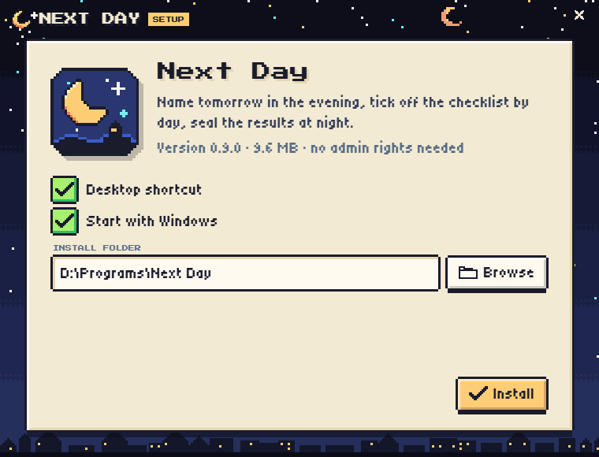

Download the installer from Releases and run it. Admin rights are not needed, you can choose the folder, and two checkboxes add a desktop shortcut and start the app with Windows. New versions install themselves while the window is hidden in the tray. Auto update can be turned off in the settings. To remove the app, use Apps in the Windows settings.

### Build

You need Node.js and Rust.

```
npm install
npm run release
```

The installer appears in `release/NextDaySetup.exe`.

If the signing key `~/.tauri/next-day.key` exists, `latest.json` appears next to it. Attach it to the release together with the installer, then installed copies update themselves.

To run the app for development:

```
npm run tauri dev
```

### License

MIT

</details>
